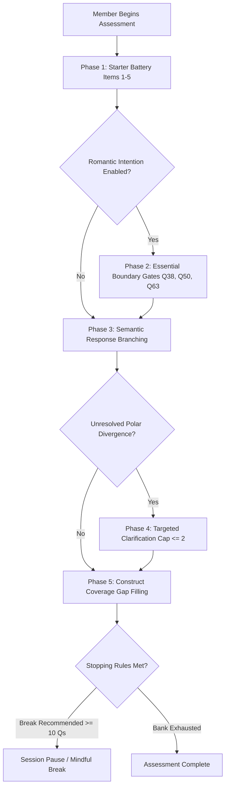

# KITHRA — ADAPTIVE QUESTION SELECTION & STOPPING RULES SPECIFICATION

**Document Reference:** `KITHRA_ADAPTIVE_SELECTION_SPEC.md`  
**Engine Implementation:** `selectNextAdaptiveQuestion()` in `src/domain/adaptiveQuestionEngine.ts`  
**Founder Directive:** *"Each carefully selected question should help resolve a meaningful uncertainty, inspired by the 21-card analogy. More questions should not automatically be considered better."*  
**Date:** November 2026

---

## 1. THE 21-CARD PROGRESSIVE UNCERTAINTY NARROWING MODEL

In the classic 21-card trick, three successive, non-repetitive deals reduce the search space from 21 possibilities down to a single card with mathematical certainty ($21 \to 7 \to 3 \to 1$). 

Kithra adapts this philosophical principle to human understanding:
- Every question must earn its place by resolving a meaningful ambiguity in the member's relational profile.
- Asking 100 questions indiscriminately is an admission of algorithmic inefficiency.
- The engine progressively transitions through 5 stages of inquiry:
  1. **Starter Battery:** Calm, consistent initial onboarding.
  2. **Essential Boundary Gates:** Critical mutual compatibility gates for romantic spaces.
  3. **Semantic Response Branching:** Dynamic follow-ups exploring nuances of specific endorsements.
  4. **Situational Triangulation:** Testing contextual adaptability across spheres.
  5. **Construct Gap Filling:** Balancing multidimensional measurement without repetitive redundancy.

---

## 2. THE 8 CANDIDATE-SELECTION REASONS & HIERARCHY

`selectNextAdaptiveQuestion()` returns an explicit, explainable `selectionReason` and `adaptiveCategory`:

| Priority Rank | Adaptive Category | Selection Reason | Operational Logic |
|---|---|---|---|
| **P0** | `contextual_clarification` | `contextual_clarification` | Triggered when a polar discrepancy in an equivalent context requires gentle, non-accusatory self-clarification (capped at $\le 2$ per facet). |
| **P1** | `initial_coverage` | `starter_battery` | Fixed administration of Items 1–5 (`q-pace`, `q-02-workweek-reply`, `q-03-first-meetup`, `q-04-listening-role`, `q-05-voice-vs-text`) to establish initial conversational baseline. |
| **P2** | `intention_specific` | `essential_boundary_gate` | For Dating and Matrimony, prioritizes critical non-negotiable gates (`q-38` relationship structure, `q-50` children goals, `q-63` smoking requirements) to prevent mismatched matching. |
| **P3** | `semantic_branch` | `semantic_branch` | Evaluates the specific option chosen on a prior question. If that option defines `branchToQuestionId`, the engine explores that branch next. |
| **P4** | `contextual_clarification` | `response_triangulation_pair` | If an item belongs to a defined triangulation cluster (e.g., `repair_after_conflict`), prioritizes an unanswered companion item to evaluate situational nuance. |
| **P5** | `facet_gap` | `construct_coverage_gap` | Identifies the construct with the lowest number of answered observations and administers its highest-discriminative unadministered candidate. |
| **P6** | `optional_deeper_exploration` | `section_progression` | If the member explicitly selects a specific profile section in the UI (e.g., *Finances & Independence*), prioritizes items from that section. |
| **P7** | `assessment_complete` | `bank_exhausted` | All eligible candidate items for the member's enabled intentions have been answered or skipped. Halts questioning cleanly. |

---

## 3. REAL REACT FLOW INTEGRATION (`MemberViews.tsx`)

Unlike naive architectures where adaptive selection is a dormant backend helper, Kithra integrates the engine directly into the React assessment lifecycle:

1. **Option Selection:** When `onSelectAssessmentAnswer(questionId, optionId, optIdx)` is invoked:
   - The answer is persisted in `memberStore`.
   - `memberStore.getNextAdaptiveQuestionForMember()` dynamically computes the next best candidate.
   - The UI advances directly to that question.
2. **Visual Transparency:** The question card displays an adaptive badge indicating why the question was surfaced:
   - `[Adaptive: Initial Coverage · Starter Battery]`
   - `[Adaptive: Semantic Branch · Exploring Decompression Nuance]`
   - `[Adaptive: Contextual Triangulation · Workplace Discretion]`
   - `[Adaptive: Coverage Gap · Balancing Financial Philosophy]`
3. **Skip & Return:** When a member clicks *"Skip / Prefer not to say"*, `memberStore.skipAssessmentQuestion()` records the skip without lowering profile readiness, and the adaptive engine selects the next non-skipped candidate.

---

## 4. RIGOROUS STOPPING RULES (TASK 8)

Questioning terminates automatically when any of the following seven stopping conditions are satisfied:

1. **Session Fatigue Guardrail:** When a member completes 10 questions in a single continuous sitting, `breakRecommended: true` is emitted with an encouraging break advisory:
   > *"You have answered 10 thoughtful questions in this sitting. There is no rush—your progress is saved in real time."*
2. **Bank Exhaustion:** When all applicable questions for the member's enabled intentions are answered or skipped, questioning stops with `adaptiveCategory: 'assessment_complete'`.
3. **Redundancy Ceiling:** When a continuous facet has 3+ coherent observations, further questions in that specific facet are suppressed in favor of unmeasured constructs.
4. **Member-Requested Topic Skip:** When a member skips an entire section or voluntary sensitivity item, the engine respects the decision and never re-presents it.
5. **Clarification Cap:** Targeted clarifications are strictly capped at $\le 2$ attempts per unresolved facet. If still unresolved, the engine marks the facet uncertain (`score: null`) and stops asking repetitive questions.
6. **Independence of Profile Readiness:** Account profile readiness (0–100%) reaches 100% based on basic profile data and relationship intentions alone. Deeper psychological reflection is 100% voluntary and never blocks profile discovery.
7. **Honest Uncertainty:** When candidate questions are exhausted, the engine admits incomplete data rather than fabricating artificial precision or synthetic filler questions.

