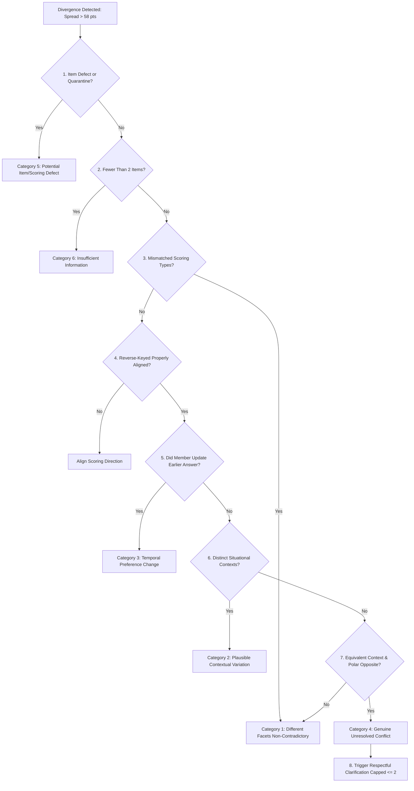

# KITHRA — CONTRADICTION RESOLUTION & EVIDENCE REVIEW DECISION MATRIX

**Document Reference:** `KITHRA_CONTRADICTION_DECISION_MATRIX.md`  
**Engine Implementation:** `evaluateTriangulationEvidence()` in `src/domain/triangulationEngine.ts`  
**Founder Objective:** *"Determine whether the variation reflects different contexts, different facets, confusing items, changing preferences, or possible careless responding. Never accuse the member of dishonesty."*  
**Date:** November 2026

---

## 1. THE 8-POINT EVIDENCE REVIEW PROCESS

When two or more answers on related topics exhibit divergent normalized scores ($\text{spread} > 58$), Kithra executes an automated, deterministic 8-point evidence review before drawing any conclusions:



### The 8 Review Checkpoints in Detail

1. **Item Defect & Quarantine Check:** Is either item flagged with a known wording ambiguity, pending translation review (`machine_translation_pending_human_review`), or listed in `quarantinedQuestionIds`? If yes, route to Category 5 immediately.
2. **Observation Sufficiency Check:** Are there at least two valid responses for this specific facet? If $< 2$, confidence remains provisional and no divergence can be claimed (Category 6).
3. **Construct & Facet Comparability:** Do the questions measure the exact same behavioral construct? If one item evaluates categorical relationship exclusivity and another evaluates communication cadence, they are not mathematically comparable.
4. **Directional Alignment:** Are reverse-keyed items inverted properly? The engine verifies $x_{\text{norm}} = 100 - x_{\text{raw}}$ before calculating numerical differences.
5. **Temporal Revision Detection:** Has the member recently answered a newer version of the question? If an answer was revised, the older response is superseded without recording a conflict.
6. **Situational Context Differentiation:** Do the scenarios differ in environmental stakes, physical fatigue, or social sphere? (e.g., public celebration vs. exhaustion after work, or corporate workplace discretion vs. close friend transparency).
7. **Equivalent Context Equivalence:** Do both items describe equivalent, high-stakes scenarios with opposite behavioral commitments? If yes, and $\text{spread} > 58$, classify as Category 4.
8. **Clarification Feasibility:** Can a single, non-accusatory follow-up resolve the ambiguity without repetitive badgering? Enforce an experimental cap of $\le 2$ clarification items per facet per session.

---

## 2. THE 6 EVIDENCE CATEGORIES & SYSTEM RESPONSES

| Category ID | Name | Criteria | System Action | User-Facing Explanation |
|---|---|---|---|---|
| `Cat-1` | **Different Facets, Non-Contradictory** | Items measure distinct sub-facets (e.g., social enjoyment vs. solitude requirement). | Maintain independent scores for each facet. Zero contradiction signal. | *"Your responses in this area reflect diverse, multi-dimensional preferences."* |
| `Cat-2` | **Plausible Contextual Variation** | Items describe distinct environments (workplace discretion vs. personal family sharing). | Record healthy contextual nuance. Zero penalty on profile readiness. | *"Your answers reflect healthy situational adaptability across different settings."* |
| `Cat-3` | **Temporal Change in Preference** | Member revisited an item or changed an earlier response during session. | Update derived vectors and dynamic matches with latest answer. | *"Your updated answers have been recorded and your profile reflections refreshed."* |
| `Cat-4` | **Genuine Unresolved Conflict** | Paired anchors describe equivalent scenarios with directly opposing choices ($\text{spread} > 58$). | Trigger polite clarification request (capped $\le 2$ per session). Never suspend or accuse. | *"Your responses point in different directions across similar situations. Would you like to clarify what best fits your everyday approach?"* |
| `Cat-5` | **Potential Item or Scoring Defect** | Item is quarantined, unvalidated translation, or has reported cognitive defect. | Quarantine candidate item. Zero penalty on member readiness. | *"We are reviewing the wording of questions in this topic. Your profile readiness is unaffected."* |
| `Cat-6` | **Insufficient Information** | Fewer than 2 items answered for facet. | Mark facet provisional. Return `score: null` if $< 2$ comparable constructs exist. | *"You have answered 1 scenario in this area. Answering further scenarios over time builds a clearer picture."* |

---

## 3. WORKED EXAMPLES: SOCIABILITY, CONFLICT & BOUNDARIES

### Case Study A: The "Outgoing yet Private" Member (Category 2)
- **Question 26:** *Cultural festival with 200 people.* Member selects: *"Feel energized by the vibrant crowd"* (Score: 85).
- **Question 27:** *Friday night after a grueling workweek.* Member selects: *"Need complete silence and solitary recharge"* (Score: 20).
- **Naive Algorithm Result:** $\text{spread} = 85 - 20 = 65 > 58 \implies \text{CONTRADICTION FLAG!}$ *(WRONG)*
- **Kithra Evidence Review Result:**
  - Context 26: `cultural_festival_energy` (Annual high-vitality ritual)
  - Context 27: `workweek_fatigue` (Physical and cognitive depletion)
  - Result: **Plausible Contextual Variation (Category 2)**.
  - Profile Impact: The member is accurately understood as someone with a dynamic social battery that expands for celebrations and contracts for necessary rest. Zero contradiction recorded.

### Case Study B: Opposite Stances in Heated Conflict (Category 4)
- **Question 72:** *In a heated dispute with a companion.* Member selects: *"I insist on an immediate 30-minute pause to calm down"* (Score: 90).
- **Question 20:** *In a heated dispute when someone raises their voice.* Member selects: *"I insist on staying in the room and continuing until it is finished"* (Score: 20).
- **Kithra Evidence Review Result:**
  - Both scenarios test the same facet (`conflict_de_escalation_pacing`) under equivalent conditions (heated dispute).
  - Spread $= 90 - 20 = 70 > 58$.
  - Result: **Genuine Unresolved Conflict in Equivalent Context (Category 4)**.
  - System Action: Surfaces an optional clarification card: *"Does your approach to conflict pauses depend on how close you are to the person, or would you like to update your earlier choice?"*

### Case Study C: Categorical Diet Gate vs. Health Trait (Category 1)
- **Question A (Categorical Gate):** *Dietary commitment.* Choice: *"Strict Vegetarian / Vegan"*.
- **Question B (Continuous Trait):** *Openness to new global cuisines.* Choice: *"Love exploring adventurous foreign dishes"* (Score: 90).
- **Kithra Evidence Review Result:**
  - An adventurous vegetarian loves Thai or Italian vegetarian dishes. Categorical dietary restriction is NOT an inhibition to cultural curiosity.
  - Result: **Different Facets Non-Contradictory (Category 1)**.

---

## 4. AUDIT TRACEABILITY & RECOVERY DATA MODEL

Every triangulation evidence review preserves full audit traceability:

```ts
export interface ItemEvidenceTrace {
  questionId: string;       // e.g., 'q-26-festival-celebration-context'
  version: string;          // e.g., 'v1.0'
  contextTag: string;       // e.g., 'cultural_festival_energy'
  facetId: string;          // e.g., 'sociability_enjoyment'
  normalizedValue: number;  // e.g., 85
  semanticOptionId: string; // e.g., 'opt-q26-energized'
  answeredAt?: number;      // Epoch ms timestamp
}
```

This ensures that any derived insight or clarification prompt can be traced directly back to the original item versions, eliminating "black-box" accusations.

