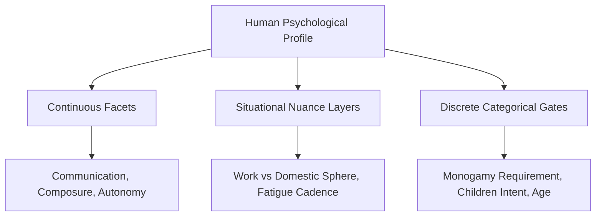

# KITHRA — MULTIDIMENSIONAL FACET & CONSTRUCT DICTIONARY

**Document Reference:** `KITHRA_FACET_AND_CONSTRUCT_DICTIONARY.md`  
**Founder Directive:** *"Do not treat every psychological characteristic as a single binary or numerical line. A person can enjoy large gatherings and still need solitude afterward."*  
**Architecture:** `FACET_CATALOG` in `src/domain/triangulationEngine.ts`  
**Status:** Calibrated Staging Specification (November 2026)

---

## 1. THE MULTIDIMENSIONAL PRINCIPLE

Human relational behavior cannot be reduced to single binary axes (e.g., "Extrovert vs. Introvert" or "Thinker vs. Feeler"). A single trait label often obscures vital, distinct psychological facets that vary by context, environment, and physical fatigue.

Kithra enforces three architectural boundaries across all measurement layers:
1. **Continuous Facets:** Dimensional behavioral tendencies scored on a continuous 0–100 scale (e.g., social enjoyment, crisis composure).
2. **Situational Nuances:** Context-dependent behavioral adaptations (e.g., energy recovery after work fatigue vs. celebration vitality).
3. **Discrete Categorical Gates:** Mutual requirements that are non-compensable and must NEVER be averaged into continuous traits (e.g., monogamy commitment structure, children goals).

---

## 2. THE 10 RELATIONAL CONSTRUCTS & FACET SPECIFICATIONS

### 1. SOCIABILITY & SOCIAL BATTERY

| Facet Identifier | Measurement Type | Operational Definition | Contextual Sensitivities | Research Reference |
|---|---|---|---|---|
| `sociability_enjoyment` | Continuous Facet | Pleasure and vitality derived from interpersonal gatherings. | Cultural festivals, community celebrations | DeYoung (2015) Cybernetic Big Five Theory |
| `sociability_confidence` | Continuous Facet | Psychological ease and assertiveness in unfamiliar social groups. | Large parties, public networking events | Costa & McCrae (1992) NEO-PI-R |
| `sociability_group_size` | Continuous Facet | Preference for large group festivities vs intimate gatherings. | Wedding functions vs small dinner circles | Asendorpf (2000) Social Inhibition |
| `sociability_one_to_one` | Continuous Facet | Preference for deep, focused single-companion dialogue. | Evening walks, quiet coffee dialogues | Aron et al. (1997) Interpersonal Closeness |
| `sociability_need_for_solitude` | Continuous Facet | Requirement for private solo time to decompress and reflect. | Post-work decompression, weekend balance | Burger (1995) Individual Desirability for Solitude |
| `sociability_energy_recovery` | Situational Nuance | Pacing required to replenish battery after intense socializing. | Saturday quiet morning after Friday event | Meijman & Mulder (1998) Effort-Recovery Model |
| `sociability_contextual_fatigue`| Situational Nuance | Impact of professional workload and transit on social availability. | High-pressure deadlines, commute fatigue | Repetti (1989) Work Stress and Domestic Energy |

---

### 2. CONFLICT RESOLUTION & REPAIR

| Facet Identifier | Measurement Type | Operational Definition | Contextual Sensitivities | Research Reference |
|---|---|---|---|---|
| `conflict_de_escalation_pacing` | Continuous Facet | Immediate time-out to regulate heart rate vs prompt resolution. | Diffuse physiological arousal (heart rate >100 bpm) | Gottman (1999) DPA & 20-minute de-escalation |
| `conflict_repair_bid_receptivity`| Continuous Facet | Receptivity to humor, soft touch, or reconciliation attempts. | Mid-argument cooling period, peace offerings | Gottman & Silver (2015) Seven Principles |
| `conflict_apology_language` | Continuous Facet | Value placed on verbal admission, restitution, or behavior change. | Interpersonal hurt, breach of relational trust | Chapman & Thomas (2006) The Five Languages of Apology |
| `conflict_flooding_management` | Situational Nuance | Cognitive ability to listen without defensive stonewalling. | Emotional exhaustion, raised voice tone | Markman et al. (1993) Prevention & Relationship Enhancement |

---

### 3. EMOTIONAL REGULATION & COMPOSURE

| Facet Identifier | Measurement Type | Operational Definition | Contextual Sensitivities | Research Reference |
|---|---|---|---|---|
| `emotional_stress_spillover` | Continuous Facet | Ability to contain work stress and protect domestic peace. | Workplace deadline crunch, end-of-day transit | Story & Repetti (2006) Daily Occupational Stressors |
| `emotional_crisis_composure` | Continuous Facet | Steadiness, practical grounding, and calm during sudden crises. | Travel delays, medical scares, logistics breakdown | Gross (2002) Emotion Regulation |
| `emotional_frustration_tolerance` | Continuous Facet | Patience when everyday routines, services, or appointments fail. | Traffic congestion, domestic logistical errors | Carver (2004) Self-Regulation of Action & Affect |

---

### 4. TRUST & BOUNDARIES

| Facet Identifier | Measurement Type | Operational Definition | Contextual Sensitivities | Research Reference |
|---|---|---|---|---|
| `trust_vulnerability_pacing` | Continuous Facet | Rate at which private vulnerabilities and life history are shared. | Early dating vs established partnership | Altman & Taylor (1973) Social Penetration Theory |
| `trust_confidentiality_boundaries`| Situational Nuance | Maintaining corporate confidentiality while being open at home. | Professional disclosure vs marital transparency | Petronio (2002) Communication Privacy Management |
| `trust_cross_gender_friendships` | Continuous Facet | Comfort with partner's independent platonic friendships. | One-on-one lunches, social media messaging | Guerrero & Bachman (2008) Cross-Sex Friendships |

---

### 5. HONESTY & ACCOUNTABILITY

| Facet Identifier | Measurement Type | Operational Definition | Contextual Sensitivities | Research Reference |
|---|---|---|---|---|
| `honesty_mistake_admission` | Continuous Facet | Directness and speed in acknowledging fault without deflection. | Unintended relational blunders, work errors | Tyler (2006) Procedural Justice & Accountability |
| `honesty_tactful_candor` | Continuous Facet | Balance between blunt transparency and protective kindness. | Sensitive feedback, partner's self-esteem | Levine (2014) Deception Theory & Prosocial Truth |
| `honesty_public_private_congruence`| Continuous Facet | Alignment between public reputation and private relational conduct. | Family gatherings vs private domestic life | Kernis & Goldman (2006) Authenticity Inventory |

---

### 6. INDEPENDENCE & COUPLE SPACE

| Facet Identifier | Measurement Type | Operational Definition | Contextual Sensitivities | Research Reference |
|---|---|---|---|---|
| `independence_solo_space` | Continuous Facet | Comfort spending weekends or evenings on solo pursuits. | Personal creative projects, solo travel | Baxter (1990) Dialectical Contradictions in Relationships |
| `independence_autonomy_in_routines`| Continuous Facet | Degree of shared schedule coordination vs independent pacing. | Daily meals, workout routines, sleep schedules | Deci & Ryan (2000) Self-Determination Theory |
| `independence_reassurance_needs` | Continuous Facet | Need for frequent verbal or digital touchpoints during workday. | Busy work shifts, remote travel | Mikulincer & Shaver (2016) Attachment in Adulthood |

---

### 7. FAMILY BOUNDARIES & FILIAL RESPONSIBILITY

| Facet Identifier | Measurement Type | Operational Definition | Contextual Sensitivities | Research Reference |
|---|---|---|---|---|
| `family_elder_caregiving_duty` | Continuous Facet | Stance on direct cohabitation and hands-on care for aging parents. | Intergenerational living, elder health transitions | Sonawat (2001) Families in India: Filial Responsibility |
| `family_in_law_buffering` | Continuous Facet | Preference for couple decision primacy vs parental consensus. | Major financial choices, domestic arrangements | Trost (1999) The Family and Boundary Management |
| `family_festive_sharing` | Situational Nuance | Equitable distribution of festival and holiday time across families. | Diwali, Eid, Christmas, family weddings | Roer-Strier & Rosenthal (2001) Family Traditions |

---

### 8. FINANCIAL STEWARDSHIP & DECISION ARCHITECTURE

| Facet Identifier | Measurement Type | Operational Definition | Contextual Sensitivities | Research Reference |
|---|---|---|---|---|
| `finance_spending_autonomy` | Continuous Facet | Currency threshold below which purchases require no consultation. | Routine personal shopping vs major assets | Dew (2008) Debt and Marriage Conflict |
| `finance_emergency_preparedness`| Continuous Facet | Minimum months of liquid expenses required for peace of mind. | Market downturns, career transition periods | Britt et al. (2016) Financial Therapy & Money Scripts |
| `finance_account_structure` | Categorical Preference| Joint pooled finances vs separate accounts with shared pool. | Marriage agreements, domestic bill splitting | Treas (1993) Money in the Bank: Transaction Costs in Marriage |

---

### 9. WORK STYLES & COFOUNDER SYNERGY (ISOLATED BETA SPACE)

| Facet Identifier | Measurement Type | Operational Definition | Contextual Sensitivities | Research Reference |
|---|---|---|---|---|
| `work_execution_cadence` | Continuous Facet | Rapid MVP experimentation velocity vs disciplined methodical QA. | Early prototype stage vs revenue scaling | Ries (2011) The Lean Startup Methodology |
| `work_decision_architecture` | Continuous Facet | Unanimous founder consensus vs functional domain autocracy. | Strategic pivots, product architecture choices | Wasserman (2012) The Founder's Dilemmas |
| `work_risk_appetite` | Continuous Facet | Comfort with bootstrapping on personal savings vs venture capital. | Runway depletion, equity dilution decisions | Sarasvathy (2001) Effectuation in Entrepreneurship |

*Privacy Firewall Rule:* Cofounder work style traits are strictly isolated and NEVER used to rank romantic suitability in Dating or Matrimony.

---

### 10. DISCRETE CATEGORICAL RELATIONSHIP GATES

| Gate Identifier | Format Type | Discrete Categories | Matching Behavior |
|---|---|---|---|
| `rel_relationship_structure` | Categorical Gate | Monogamous · Open / Polyamorous · Questioning | Strict symmetric mutual gate; non-compensable |
| `rel_children_goal` | Categorical Gate | Definite yes · Open to children · Definite no / Childfree | Strict mutual gate in Matrimony; voluntary in Dating |
| `rel_dating_purpose` | Categorical Gate | Committed long-term · Open to marriage · Intentional dating | Strict gate in Dating; casual hookup intention excluded |
| `rel_smoking_requirement` | Categorical Gate | Must be non-smoker · Vape acceptable · No preference | Strict gate based on personal habit and partner requirement |

---

## 3. SUMMARY: PRESERVING FACET INDEPENDENCE

By decomposing monolithic traits into these distinct facets, Kithra ensures that a member's multi-layered human nature is respected. A member who answers high on `sociability_enjoyment` and high on `sociability_need_for_solitude` is understood as an individual who enjoys full-hearted celebration followed by deep restorative quiet—a balanced human, not an impossible contradiction.

