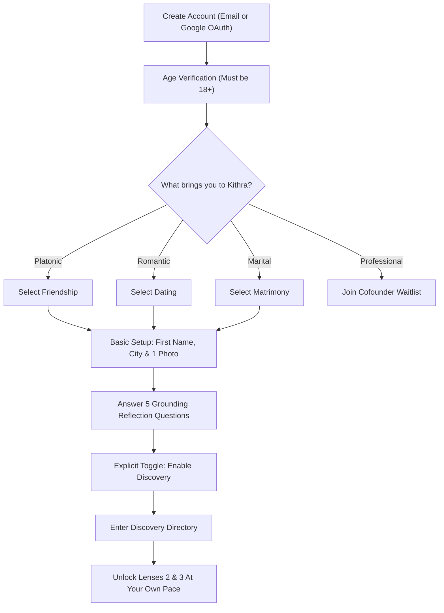

# KITHRA — MEMBER UX FLOWCHARTS & JOURNEY BLUEPRINTS
**Document Reference:** `KITHRA_MEMBER_UX_FLOWCHARTS.md`  
**Phase:** 10 (User Experience Architecture)  
**Standard:** Unhurried Onboarding, Cognitive Clarity & Complete Journey Specifications  

---

## 1. Redesigned Onboarding Workflow (Zero Overwhelm)

To prevent cognitive fatigue, new members are never forced to set up 4 profiles or answer 60 questions on Day 1.

---

## 2. The 18 Canonical User Journeys (A through R)

Below is the definitive reference for how the platform handles every permutation of member intent, interaction, and state change:

### Journey A: Friendship-Only Member
* **What they see:** Only members active in Friendship; community circles; shared book/walk topics.
* **What is hidden:** All romantic filters, matrimony biodatas, and relationship structure questions.
* **Permissions:** Can RSVP to circles, send friendship notes, upload casual gallery photos.

### Journey B: Dating-Only Member
* **What they see:** Compatible daters filtered by romantic non-negotiables (monogamy/polyamory, pace).
* **What is hidden:** Family in-law living arrangements; cofounder business metrics.

### Journey C: Matrimony-Only Member
* **What they see:** Serious marriage candidates; family expectation alignment; pre-marriage discussion kits.
* **What is hidden:** Casual dating profiles; friendship-only members.

### Journey D: Cofounder-Only Member (Beta)
* **What they see:** Business builders filtered by stage, tech/GTM skills, runway, and commitment hours.
* **What is hidden:** All personal dating, marital, and personal lifestyle traits.

### Journey E: Friendship + Dating Member
* **Experience:** Switches between Friendship and Dating via the top navigation tabs.
* **Privacy:** Friendship photos and Dating portraits carry separate visibility switches.
* **Firewall:** A friend never sees their dating profile unless both independently enter Dating.

### Journey F: Dating + Matrimony Member
* **Experience:** Daters exploring serious partnership without rushing into immediate matrimony.
* **Isolation:** Matrimony in-law and finance answers remain invisible to casual dating matches.

### Journey G: Friendship + Dating + Matrimony Member
* **Experience:** Full personal connection suite. Three completely independent lens directories.
* **Consistency:** One single 1-Year Pass covers all three without overlapping billing.

### Journey H: All Four Spaces Member
* **Experience:** The complete universal account.
* **Invariant:** Professional cofounders are strictly firewalled from romantic recommendations.

### Journey I: Two Users with No Shared Intention
* **Setup:** User A is Friendship-only; User B is Dating-only.
* **Outcome:** Mutually invisible. Search results return 0 results. Direct URLs return 404.

### Journey J: Two Users with One Shared Intention
* **Setup:** User A (Friendship + Dating); User B (Dating + Matrimony).
* **Outcome:** Discoverable **only in Dating**. Completely invisible in Friendship and Matrimony.

### Journey K: Two Users with Several Shared Intentions
* **Setup:** Both User A and User B have Friendship AND Dating enabled.
* **Outcome:** Both can be discovered in either tab. Introductions are explicitly tagged to the space in which they are initiated.

### Journey L: Cofounders Who Later Enable Dating / Matrimony
* **Scenario:** Alice and Bob meet as cofounders. Later both activate Dating.
* **Firewall:** Kithra automatically suppresses them from each other's Dating feeds (`cross_context_connection_suppressed`).

### Journey M: Friends Where One Wants Dating and the Other Doesn't
* **Scenario:** Alice and Bob are connected in Friendship. Alice enables Dating; Bob does not.
* **Safety:** Alice cannot send dating requests to Bob. Friendship thread is locked to platonic rules. Any romantic pressure can be reported with 1 click.

### Journey N: Dating Connection Where One Person Changes Intention
* **Scenario:** Alice and Bob are dating on Kithra. Alice decides to pause dating and focus on friendship.
* **Behavior:** Existing Dating chat is archived. Bob's profile is not automatically imported into Alice's Friendship feed without mutual opt-in.

### Journey O: Pending Invitation When One Side Disables Discovery
* **Scenario:** User A sends a note to User B. User B disables Dating discovery the next day.
* **Behavior:** The pending note remains in User B's private inbox for 14 days, but User B is removed from new discovery feeds.

### Journey P: Existing Connection When a Space is Paused
* **Scenario:** User A pauses Matrimony.
* **Behavior:** User A's profile vanishes from Matrimony search, but existing accepted chats remain open to communicate respect and closure.

### Journey Q: Global Block and Account Deletion
* **Block:** Symmetrically terminates all chats and discovery in 0 milliseconds across all 4 spaces.
* **Deletion:** Permanently purges all raw answers, vectors, and photos under Section 12 DPDP Act 2023.

### Journey R: Free User vs. Paid User Encounter
* **Interaction:** A Free member and a Paid 1-Year Pass member match.
* **Equality:** Both can send and receive thoughtful notes. Safety, blocking, and mutual reflections are identical. The free user is never subjected to artificial timeouts or degraded match quality.

