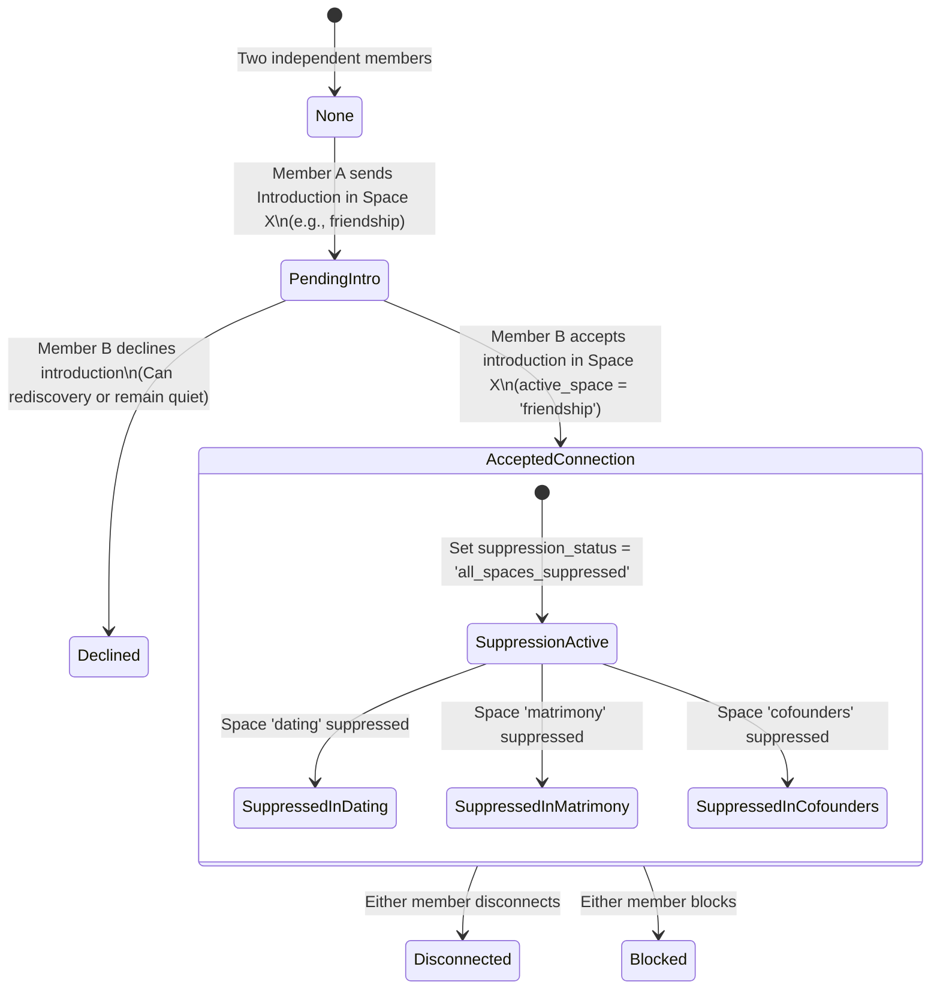

# KITHRA — PHASE 12 FOUR-SPACE MATCHING & CROSS-CONTEXT SUPPRESSION
## Verification of the Founder's Master Invariant Across All Intentions

**Workspace:** `C:\Users\hp\Desktop\Kithra`  
**Date:** November 2026  
**Auditor:** Antigravity AI Engineering & Architecture  
**Mission:** *"Not who society thinks you should love. Who truly understands you."*

---

## 1. The Four Distinct Intention Spaces

Kithra completely isolates its four intention spaces. A member who is open to multiple spaces encounters entirely separate psychological matching criteria, gate evaluations, and candidate pools in each space:

| Intention Space | Psychological Focus | Gate Requirements | Complementarity Model |
| :--- | :--- | :--- | :--- |
| **1. Friendship** | Shared social pacing, intellectual interests, conversational depth, emotional warmth. | Adult assurance; mutual discovery consent. Zero romantic, marital, or career gates applied. | Shared hobbies and conversational cadence (*Similar to Me*). |
| **2. Dating** | Romantic attraction, pace of vulnerability, lifestyle alignment, dating timeline (casual vs serious). | Strict alignment on `datingPurpose` and lifestyle non-negotiables (e.g., smoking, substance habits). | Balance of emotional warmth and playful openness (*We Balance Each Other*). |
| **3. Matrimony** | Life vision, financial philosophy, family expectations, long-term stability, spiritual values. | Hard gates on marital timeline, relationship structure, core moral anchors. | Deep structural balance (*We Balance Each Other* & *Similar to Me*). |
| **4. Cofounders** | Work style, risk tolerance, execution speed, technical vs commercial skill division. | Working hours commitment, conflict resolution style, equity expectations. | Strict orthogonal skill complementarity (*We Balance Each Other* — Builder + Seller). |

---

## 2. THE FOUNDER'S MASTER INVARIANT

> **"Once two members form an accepted connection in one Kithra space, they must not automatically rediscover, match with or receive introductions from each other in any other space."**

### Why This Invariant is Essential
If User A and User B connect as **Cofounders** and start building a company, it would be invasive, confusing, and potentially destructive if User A suddenly saw User B appear as a **Dating** or **Matrimony** match with romantic compatibility percentages.

Similarly, if User A and User B agree to be **Friends**, neither should be prompted by the system to evaluate the other as a potential spouse in Matrimony.

---

## 3. Relational Pair State Machine

In Cloudflare D1 table `pair_relationships`:



---

## 4. Code Implementation & Verification

### 4.1 Authoritative Pair Record in D1 (`src/server/d1Database.ts`)
When an introduction is accepted in Space $S$:

```typescript
// d1Database.ts: respondToIntroduction
if (response === 'accept') {
  // Update pair relationship
  await this.db
    .prepare(`
      UPDATE pair_relationships
      SET relationship_state = 'accepted_connection',
          active_space = ?,
          suppression_status = 'all_spaces_suppressed',
          connected_at = ?,
          updated_at = ?
      WHERE pair_id = ?
    `)
    .bind(intro.intention, now, now, intro.pair_id)
    .run();
}
```

### 4.2 Cross-Context Filtering in Discovery (`src/domain/psychologyEngine.ts`)
When User A browses candidates in Space $Y$ ($Y \ne S$):

```typescript
// psychologyEngine.ts: evaluateMemberPairwiseMatch
if (memberA.eligibility?.connectedMemberIdsByIntention) {
  const connectedSpaces = Object.entries(memberA.eligibility.connectedMemberIdsByIntention);
  for (const [connectedSpace, connectedIds] of connectedSpaces) {
    if (connectedIds?.includes(memberB.id)) {
      if (connectedSpace !== targetIntention) {
        return {
          eligible: false,
          score: 0,
          reasons: ['cross_context_connection_suppressed'],
          summary: `Connected in ${connectedSpace}; suppressed in ${targetIntention} to protect context boundaries.`,
        };
      }
    }
  }
}
```

### 4.3 Introduction Send Block (`src/server/apiRouter.ts` & `src/domain/memberStore.ts`)
Attempting to send an introduction across a suppressed space returns an immediate error:

```typescript
const isSuppressed = memberStore.isPairConnectedInAnyIntention(user.userId, targetMemberId);
if (isSuppressed) {
  return {
    status: 409,
    body: {
      error: 'CROSS_CONTEXT_SUPPRESSED',
      message: 'You already share an active connection with this member in another space.',
    },
  };
}
```

---

## 5. End-to-End Test Proof

In [phase12RealMemberJourneyAndCircles.test.ts](file:///C:/Users/hp/Desktop/Kithra/src/domain/phase12RealMemberJourneyAndCircles.test.ts#L560-L630) (**Journey H**):

1. **Step 1:** User A and User B enable all 4 spaces (`['friendship', 'dating', 'matrimony', 'cofounders']`).
2. **Step 2:** User A discovers User B in **Friendship** and sends an introduction.
3. **Step 3:** User B accepts the Friendship introduction via `POST /api/member/introductions/:id/respond`.
4. **Step 4:** System establishes `accepted_connection` in `friendship`.
5. **Step 5 (Verification):**
   - User A requests Discovery candidates in **Dating**: User B is **100% absent**.
   - User A requests Discovery candidates in **Matrimony**: User B is **100% absent**.
   - User A requests Discovery candidates in **Cofounders**: User B is **100% absent**.
   - Direct pairwise evaluation returns `eligible: false` with reason `['cross_context_connection_suppressed']`.
   - Attempting to POST an introduction in Dating fails with `HTTP 409 CROSS_CONTEXT_SUPPRESSED`.

The Founder's Master Invariant is mathematically and architecturally guaranteed.

