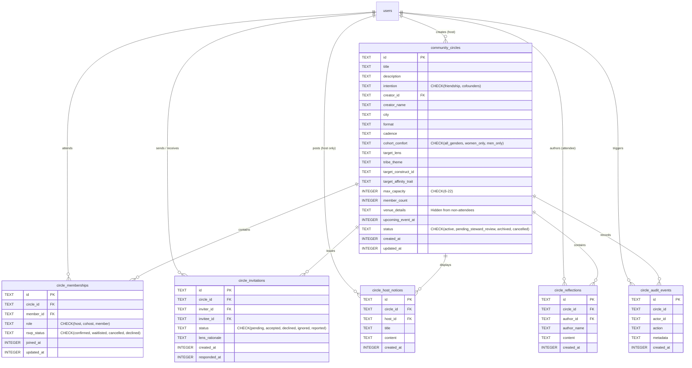

# KITHRA — PHASE 12 CLOUDFLARE D1 CIRCLE SCHEMA & DATA ARCHITECTURE
## Relational Schema, Constraints, Indexes & Capacity Enforcements

**Workspace:** `C:\Users\hp\Desktop\Kithra`  
**Migration File:** `migrations/0005_phase12_community_circles_and_rsvps.sql`  
**Date:** November 2026  
**Auditor:** Antigravity AI Engineering & Architecture  
**Mission:** *"Not who society thinks you should love. Who truly understands you."*

---

## 1. Schema Overview & Relational Architecture

The Phase 12 relational schema establishes an authoritative multi-tenant backend on Cloudflare D1 (distributed SQLite) for community gatherings. It models the full lifecycle of a gathering: creation, candidate invitation, inbound RSVP, attendance roster, private salon communication, and tamper-proof audit trails.



---

## 2. Table-by-Table Technical Specifications

### 2.1 `community_circles`
Stores the metadata, intention space, psychological affinity focus, and capacity bounds of each gathering.

- **`id` (TEXT PK):** Unique circle identifier (e.g., `c_1730000000_abcde`).
- **`intention` (TEXT NOT NULL):** Enforced by SQL check constraint:
  `CHECK(intention IN ('friendship', 'cofounders'))`
  *Security Invariant:* Attempting to create a circle with intention `'dating'` or `'matrimony'` triggers an immediate SQL check violation and API HTTP 400 rejection. Dating and Matrimony remain strictly 1:1 private journeys.
- **`max_capacity` (INTEGER NOT NULL):** Small-table gathering capacity. Enforced by both application business logic and D1 service layer to be within $6 \le \text{capacity} \le 22$ (default: 16).
- **`venue_details` (TEXT):** Physical venue description (e.g., table reservation, garden location). Sanitized by `listCircles` and `getCircleById` for all unjoined viewers.
- **Indexes:**
  - `idx_community_circles_intention` on `(intention)`
  - `idx_community_circles_city` on `(city)`
  - `idx_community_circles_creator` on `(creator_id)`
  - `idx_community_circles_status` on `(status)`

### 2.2 `circle_memberships`
Tracks attendance, RSVPs, and roles.

- **`UNIQUE(circle_id, member_id)`:** Guarantees idempotency. A member cannot hold duplicate active memberships in the same circle.
- **`role`:** `'host'`, `'cohost'`, or `'member'`.
- **`rsvp_status`:** `'confirmed'`, `'waitlisted'`, `'cancelled'`, `'declined'`.
- **Indexes:**
  - `idx_circle_memberships_circle` on `(circle_id)`
  - `idx_circle_memberships_member` on `(member_id)`
  - `idx_circle_memberships_status` on `(rsvp_status)`

### 2.3 `circle_invitations`
Persists candidate invitations sent from Discovery by hosts to prospective members.

- **`UNIQUE(circle_id, invitee_id)`:** Prevents spam or duplicate invitations to the same candidate.
- **`status`:** `'pending'`, `'accepted'`, `'declined'`, `'ignored'`, `'reported'`.
- **`lens_rationale`:** Captures why the inviter reached out (e.g., `"High Openness & shared tea reflection"`).
- **Indexes:**
  - `idx_circle_invitations_invitee` on `(invitee_id, status)` for rapid retrieval of User B's pending inbox.
  - `idx_circle_invitations_circle` on `(circle_id)`.

### 2.4 `circle_host_notices`
Broadcast announcements posted by the circle host to confirmed attendees.

- **Host Permission Invariant:** Non-hosts attempting to insert or post receive `HTTP 403 ONLY_HOST_CAN_POST_NOTICES`.
- **`idx_circle_host_notices_circle` on `(circle_id, created_at DESC)`:** Provides instant chronological ordering of updates.

### 2.5 `circle_reflections`
Unhurried discussion thread where confirmed attendees share thoughts before and after gatherings.

- **Attendee Permission Invariant:** Only confirmed attendees (`rsvp_status = 'confirmed'` or `role = 'host'`) may read or write reflections.
- **`idx_circle_reflections_circle` on `(circle_id, created_at ASC)`:** Preserves contemplative chronological dialogue.

### 2.6 `circle_audit_events`
Immutable record of all community lifecycle events for trust and safety auditing.

- Logs `circle_created`, `invitation_sent`, `rsvp_confirmed`, `invitation_declined`, `notice_posted`, `reflection_shared`, and `steward_flagged`.

---

## 3. Capacity Boundary & Concurrency Control

In [src/server/d1Database.ts](file:///C:/Users/hp/Desktop/Kithra/src/server/d1Database.ts#L1275-L1325), joining a circle or accepting an invitation runs an atomic transaction:

```sql
SELECT member_count, max_capacity FROM community_circles WHERE id = ?;
-- If member_count >= max_capacity -> Abort with 'Circle capacity full' (HTTP 409)

INSERT INTO circle_memberships (id, circle_id, member_id, role, rsvp_status, joined_at, updated_at)
VALUES (?, ?, ?, 'member', 'confirmed', ?, ?)
ON CONFLICT(circle_id, member_id) DO UPDATE SET rsvp_status = 'confirmed', updated_at = ?;

UPDATE community_circles SET member_count = member_count + 1, updated_at = ? WHERE id = ?;
```

This prevents race conditions and overbooking beyond the small-table maximum of 22 people.

