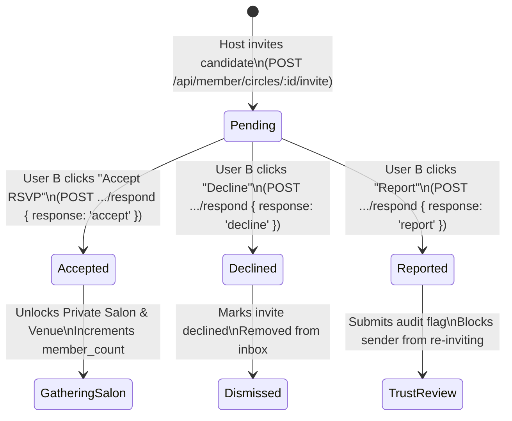

# KITHRA — PHASE 12 INVITATIONS & RSVP WORKFLOW
## User A Host Initiative, User B Inbound Inbox & Gathering Lifecycle

**Workspace:** `C:\Users\hp\Desktop\Kithra`  
**Date:** November 2026  
**Auditor:** Antigravity AI Engineering & Architecture  
**Mission:** *"Not who society thinks you should love. Who truly understands you."*

---

## 1. The Core Social Principle: "Invite, Don't Kidnap"

In typical social apps, group interactions are either public free-for-alls or intrusive auto-adds where users find themselves suddenly dropped into groups without consent.

Kithra enforces a strict social principle: **"Invite, Don't Kidnap."**
1. User A (Host) identifies an aligned candidate in Discovery (*Similar to Me*, *Different from Me*, or *We Balance Each Other*).
2. User A issues an **explicit invitation** to a specific small-table Circle.
3. User B receives a private notification in their **Messages & Conversations tab**.
4. User B has total sovereignty:
   - **Accept RSVP:** Unlocks the Gathering Salon, reveals the private venue, and adds User B to the attendee roster.
   - **Decline:** Gracefully dismisses the invite with zero social embarrassment or awkwardness for either party.
   - **Report:** Instantly submits a confidential trust & safety ticket if the invitation is predatory, spammy, or harassing.

---

## 2. Inbound Notification UI in User B's Messages Tab

In [src/components/MemberViews.tsx](file:///C:/Users/hp/Desktop/Kithra/src/components/MemberViews.tsx#L1820-L1910), when User B navigates to `ConversationsView` (`/member/conversations`), an amber-tinted **Inbound Circle Invitations Banner** appears at the top of the screen:

```tsx
{inboundCircleInvites.length > 0 && (
  <div className="rounded-xl border border-amber-300/60 bg-amber-500/10 p-5 mb-6 backdrop-blur">
    <div className="flex items-center gap-2 mb-3">
      <span className="w-2.5 h-2.5 rounded-full bg-amber-400 animate-pulse" />
      <h3 className="text-sm font-semibold tracking-wide text-amber-200 uppercase">
        Inbound Circle Invitations ({inboundCircleInvites.length})
      </h3>
    </div>
    {/* Renders each invite with Circle Name, Inviter, Reason, and Action Buttons */}
    ...
  </div>
)}
```

### Visual Structure of the Invitation Card
Each invitation card renders:
- **Circle Title:** e.g., *"Indiranagar Reading Salon"*
- **Inviter Name:** e.g., *"Ananya Rao (Circle Host)"*
- **Psychological Affinity Note:** e.g., *"Invited via Similar to Me — Shared high Openness (82) and low-stimulation coffee table preference."*
- **Action Buttons:**
  - `[ Accept RSVP & Unlock Salon ]` (Primary gold button)
  - `[ Decline ]` (Neutral text button)
  - `[ Report ]` (Discreet red link)

---

## 3. End-to-End State Machine



---

## 4. API Endpoints & State Transitions

### 4.1 Host Sends Invitation
- **Endpoint:** `POST /api/member/circles/:id/invite`
- **Request Body:** `{ candidateId: string, lensRationale?: string }`
- **Enforcements:**
  1. Only the circle host or co-host can invite.
  2. Candidate must be an adult with active discovery consent.
  3. No mutual blocks between host and candidate.
  4. Unique constraint `(circle_id, invitee_id)` prevents spamming.
- **Audit Record:** Emits `invitation_sent` event.

### 4.2 Member Lists Pending Invitations
- **Endpoint:** `GET /api/member/circles/invitations`
- **Query:** `SELECT * FROM circle_invitations WHERE invitee_id = ? AND status = 'pending'`
- **Enhancement:** Hydrates circle title, city, format, cadence, and host name for UI presentation.

### 4.3 Member Responds to Invitation
- **Endpoint:** `POST /api/member/circles/invitations/:id/respond`
- **Request Body:** `{ response: 'accept' | 'decline' | 'report' }`
- **Transactions by Action:**
  - **`'accept'`:**
    1. Checks `circle.member_count < circle.max_capacity`.
    2. Updates `circle_invitations.status = 'accepted'`.
    3. Inserts or updates `circle_memberships` record with `role = 'member'` and `rsvp_status = 'confirmed'`.
    4. Atomically increments `community_circles.member_count = member_count + 1`.
    5. Returns `{ success: true, action: 'accept' }`.
  - **`'decline'`:**
    1. Updates `circle_invitations.status = 'declined'`.
    2. Returns `{ success: true, action: 'decline' }`.
  - **`'report'`:**
    1. Updates `circle_invitations.status = 'reported'`.
    2. Inserts record into `circle_audit_events` with `action: 'invitation_reported'`.
    3. Triggers confidential trust case for steward review.

---

## 5. Security, Anti-Tamper & Idempotency Safeguards

1. **Authorization Check:** The respondent's authenticated `userId` must strictly match `circle_invitations.invitee_id`. An attacker cannot accept or decline another member's invitation.
2. **Double-Accept Prevention:** Once an invitation is marked `accepted`, re-invoking the endpoint is a no-op that returns `{ success: true }` without incrementing `member_count` a second time.
3. **Small-Table Cap Enforcement:** If all seats are filled before User B responds, the transaction fails gracefully with `HTTP 409: Circle capacity has been reached`.
4. **Zero Optimistic UI Split States:** The frontend only dismisses the invitation and opens the salon if the API returns `res.ok === true` with `{ success: true }`.

