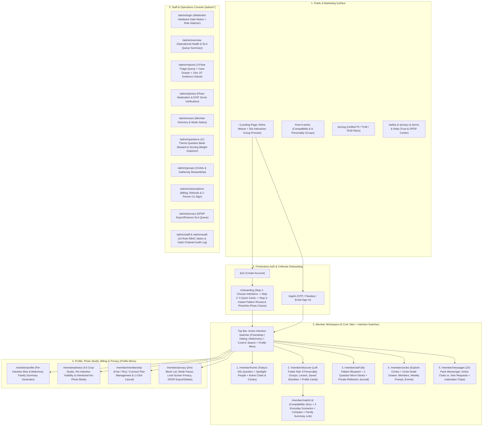

# 06 — RECOMMENDED INFORMATION ARCHITECTURE, SITEMAP & COMPLETE SCREEN REGISTER

## 1. Information Architecture Philosophy

To make Kithra feel as effortless as **Instagram**, **WhatsApp**, or **Swiggy** while preserving 100% of its deep deterministic compatibility capabilities (`FP-001`–`FP-150`, `KTH-0001`–`KTH-0194`), we apply three strict IA rules:

1. **Five Primary Destinations Maximum in Member Navigation:**
   - Human working memory navigates **5 top-level destinations** effortlessly (fitting both a **5-tab Mobile Bottom Bar** and a clean **Collapsible Desktop Sidebar**):
     1. **Home** (`/member/home`) — *Your daily pulse, 60-second reflection card, spotlight matches, and active chats.*
     2. **Discover** (`/member/discover`) — *Browse compatible people by **Personality Pattern Group folders**, compatibility lenses, and saved shortlists.*
     3. **My Pattern** (`/member/self`) — *Your own Personality Constellation story, strengths, blind spots, 1-question-at-a-time micro-assessments, and private reflection journal.*
     4. **Circles** (`/member/circles`) — *Low-pressure small-group communities (12–35 people), weekly topic threads, and local/online gatherings.*
     5. **Messages** (`/member/messages`) — *Active conversations and mutual-consent Introduction Requests with trait-based icebreakers.*
   - **Account, Profile Studio, Photos, Membership & Privacy** live cleanly in the **Top-Right Profile Menu / Bottom Sidebar Footer** (`/member/profile`, `/member/photos`, `/member/membership`, `/member/privacy`), exactly how Instagram, WhatsApp, and Swiggy separate daily browsing from account configuration.

2. **Persistent Header Intention Switcher (`Friendship` · `Dating` · `Matrimony`):**
   - Instead of creating separate menus for Matrimony or Dating, the **Top Header Intention Pill Switcher** scopes `Home`, `Discover`, `Circles`, and `Messages` to the active relationship intention with 1 tap—while keeping `My Pattern` (your core self-understanding) unified across your life, with mode-specific modules (`ROOTS` & `GROUND`) automatically highlighted when `Matrimony` is active.

3. **Three-Level Progressive Disclosure on Every Screen:**
   - **Level 1 (Scan in 3 seconds):** Visual badge, Personality Group name, 1 human sentence, 1 primary CTA.
   - **Level 2 (Understand in 30 seconds):** Drawer or tab showing Shared Ground (`Echo`), Healthy Balance (`Counterpoint`), Teamwork Fit (`Mosaic`), and 4 Everyday Scenarios.
   - **Level 3 (Verify in 2 minutes):** Optional expandable *"See theme-by-theme details"* sheet or 2-person Side-by-Side Comparison modal.

---

## 2. Visual Information Architecture Diagram

---

## 3. Complete Screen & Route Register

Every screen across Public, Auth/Onboarding, Member Workspace, Account/Privacy, Admin Console, and System States is cataloged below with its exact route, primary user goal, single primary CTA, required states, and trace to the 104-screen canonical inventory (`PUB-001..009`, `ONB-001..008`, `MEM-001..042`, `ADM-000..023`, `SYS-001..010`).

### 3.1 Public & Marketing Routes

| Route | Screen IDs | Screen Name | Primary User Goal | Primary CTA | Secondary Actions | Required UI States |
|---|---|---|---|---|---|---|
| `/` | `PUB-001` | **Landing Page** | Understand Kithra in 5 seconds; try the 3-card interactive Personality Pattern preview; see how Friendship, Dating, and Matrimony stay separate | `Get started` (`/join`) | `How it works` (scroll/route), `Try 3 sample questions` (inline widget), `Sign in` (`/signin`) | Light/Dark theme, Reduced-motion static `KithraWeave`, Interactive 3-question mini-preview state (`Q1 -> Q2 -> Q3 -> Instant Pattern Badge`) |
| `/how-it-works` | `PUB-002..004` | **How Compatibility & Personality Groups Work** | Understand the 8 Personality Pattern Groups and the 3 compatibility lenses (**Shared Ground / Echo**, **Healthy Balance / Counterpoint**, **Teamwork Fit / Mosaic**) | `Discover your pattern` (`/join`) | Interactive lens switcher (`Echo` / `Counterpoint` / `Mosaic`), Explore the 8 Personality Groups | Tabbed group preview, SVG line-linking diagram |
| `/pricing` | `PUB-005` | **Membership & Pricing** | Compare `Free (₹0)`, `Plus (₹149/mo)`, and `Connect (₹249/mo)` across 1, 3, 6, and 12-month billing cycles | `Start free` (`/join`) | Billing duration toggle (`Monthly`, `3 Months`, `6 Months`, `Annual`), FAQ accordion | Cycle price recalculation, clear "1 membership covers all 3 intentions" banner |
| `/safety` | `PUB-006` | **Trust, Safety & Boundaries** | Understand per-intention photo visibility, `0ms` cross-mode block, mutual-consent introductions, and zero staff access to raw answers | `Join safely` (`/join`) | Interactive boundary toggle demo | Interactive demo state |
| `/privacy`, `/terms`, `/help` | `PUB-007..009` | **Legal, DPDP 2023 Notice & Help Center** | Read plain-language privacy commitments, terms of service, and searchable FAQs | `Back to Kithra` (`/`) | Search FAQ input, category filter pills | Search empty state, printable layout |

### 3.2 Authentication & Progressive Onboarding Routes

| Route | Screen IDs | Screen Name | Primary User Goal | Primary CTA | Secondary Actions | Required UI States |
|---|---|---|---|---|---|---|
| `/signin` | `AUTH-001..003` | **Sign In** | Return to member workspace quickly via Phone/Email OTP, Passkey, or Password | `Continue to workspace` | `Use passkey`, `Send one-time code`, `Demo Member Login` (1-click preview), `Staff Console` (`/admin/login`) | Validation error, OTP countdown, Loading state |
| `/join` | `AUTH-004..006` | **Create Account** | Create a new Kithra account with age confirmation (`18+` for Friendship/Dating, statutory age for Matrimony) | `Create account & choose intention` (`/onboarding`) | `Already have an account? Sign in` | Age gate validation, Duplicate account notice |
| `/onboarding` | `ONB-001..008` | **3-Minute Progressive Onboarding** | **Step 1:** Pick active intention(s) (`Friendship`, `Dating`, `Matrimony`). **Step 2:** Answer 5 effortless 1-tap situational cards. **Step 3:** See instant **Provisional Personality Group badge**, set City & Basic Bio, and choose Photo or **Intentional No-Photo Mode** | `Enter Kithra` (`/member/home`) | `Skip question`, `Enable No-Photo Mode (Reveal on Connect)`, `Back` | Step 1/2/3 progress bar, Auto-advance on question tap (`250ms`), Instant Personality Group celebration card |

### 3.3 Core Member Workspace Routes (The 5 Primary Navigation Tabs)

| Route | Screen IDs | Screen Name | Primary User Goal | Primary CTA | Secondary Actions | Required UI States |
|---|---|---|---|---|---|---|
| `/member/home` | `MEM-001..002` | **1. Home (Daily Pulse)** | Feel welcomed, answer **Today's 60-Second Reflection** (1 inline card or 5-card sprint), see top 3 compatible people in the active intention, and jump into active chats or Circles | `Answer today's question` / `Explore matches` | Switch active intention (`Friendship`/`Dating`/`Matrimony`), Open match story, Resume chat | Normal, All daily questions answered celebration state, Mode paused banner |
| `/member/discover` | `MEM-014..020` | **2. Discover (Group & Folder Directory)** | Browse compatible people organized intuitively by **Left Folder Rail / Top Category Bubbles**: `All Compatible`, **8 Personality Pattern Groups** (*Steady Anchors*, *Deep Currents*, *Curious Sparks*, *Mosaic Builders*, *Warm Bridges*, *Horizon Planners*, *Calm Rhythms*, *Circle Gatherers*), **Compatibility Lens** (`Shared Ground`, `Healthy Balance`, `Teamwork Fit`), and **`Saved Shortlists`** | `View Compatibility Story` (per card) | Filter by City, Select 2 people for **Side-by-Side Comparison**, Save to Shortlist folder, Write Intro Note | Normal grid, Folder filtered state, 2-Candidate Comparison Modal, Low-coverage (<15 questions) prompt banner, Empty filter state |
| `/member/match/:id` | `MEM-021` | **Match Compatibility Story & Scenario Dossier** | Understand deeply *why* you and a candidate fit: **1. Personality Group Pairing** (*e.g., Steady Anchor + Warm Bridge*), **2. Shared Ground (`Echo`)**, **3. Healthy Differences (`Counterpoint`)**, **4. Teamwork Fit (`Mosaic`)**, **5. Four Everyday Scenarios**, and **6. Optional Measured Alignment Sheet** | `Send introduction note` | `Save to shortlist`, `Compare side-by-side`, `Share Family-Safe Summary` (when in Matrimony mode), `Block or report` (`0ms`) | Story view, Scenario card switcher, Measured Details Drawer open/closed, Intro Note Modal, Family Summary Drawer (Matrimony) |
| `/member/self` *(alias `/member/assessments`)* | `MEM-003..013` | **3. My Pattern (Self-Discovery, Micro-Questions & Journal)** | **Tab A — My Personality Story:** View your own Constellation Group, Top 3 Strengths, Communication & Conflict Repair Style, Growth Blind Spots, and **4 Everyday Scenarios**. **Tab B — 60-Second Question Decks:** Browse the 12 life themes and launch distraction-free **1-question-at-a-time auto-advancing 5-card sprints**. **Tab C — Private Reflection Journal:** Write private notes on guided prompts | `Start 5-question sprint (1 min)` | Switch pill tabs (`My Story` / `Question Decks` / `Private Journal`), Expand *"Why we ask this"*, Skip question, Print/Export personal summary | Active 1-question focus modal (`1–4` hotkeys + `250ms` auto-advance), 5-card completion micro-reward toast, Journal entry list & editor |
| `/member/circles` | `MEM-022..024` | **4. Circles (Small-Group Communities)** | Join small-group interest Circles (`12–35` people) scoped to your active intention, see which compatible members are inside, respond to the weekly discussion prompt, and RSVP to local/online gatherings | `Open Circle` / `Join Circle` | Filter by topic, **Circle Detail Drawer** (Members with Personality Group pills, Weekly Prompt replies, Upcoming Event RSVP), Post reflection | Joined vs. Explore state, Circle Detail Drawer open, Event RSVP confirmed state |
| `/member/messages` | `MEM-025..029` | **5. Messages & Intro Requests** | Converse unhurriedly in a WhatsApp-clean 2/3-pane layout with separate **`Active Chats`** and **`Intro Requests`** tabs, clickable **Trait-Based Icebreaker Chips**, and a collapsible right-hand **Match Compatibility Cheat-Sheet** | `Send message` / `Accept introduction` | Switch `Chats` vs. `Intro Requests`, Tap an Icebreaker chip, Toggle right-hand Match Summary pane, `Grant photo access`, `Pause / Block / Report` (`0ms`) | Active thread, Incoming Intro Request preview (shows compatibility summary before accepting), Empty inbox state, Report Modal (`4-step`) |

### 3.4 Account, Profile Studio, Photo Studio, Billing & Privacy Routes

| Route | Screen IDs | Screen Name | Primary User Goal | Primary CTA | Secondary Actions | Required UI States |
|---|---|---|---|---|---|---|
| `/member/profile` | `MEM-030..031`, `MEM-035..037` | **Profile Studio & Per-Intention Bios** | Edit personal details, write separate tailored bios and conversation prompts for `Friendship`, `Dating`, and `Matrimony`, and configure Matrimony practical preferences & **Family-Safe Summary Link** | `Save profile changes` | Switch intention bio tab, Generate/Revoke **Matrimony Read-Only Family Summary Link** | Per-intention bio preview, Family Summary link generated/revoked state |
| `/member/photos` | `MEM-032..034` | **Photo Studio & Intentional No-Photo Mode** | Upload photos locally (with EXIF stripping), frame in `4:5` portrait crop (`1.0x–2.0x` zoom, `90°` rotate, keyboard pan), set separate visibility per intention, or toggle **Intentional No-Photo / Warm Monogram Mode** | `Upload photo` / `Save framing` | Toggle **Intentional No-Photo Mode ("Reveal after mutual connect")**, Per-intention visibility toggles, Reorder gallery, Lightbox preview | Crop studio active, No-Photo Constellation Monogram preview, Moderation state preview |
| `/member/membership` *(alias `/member/settings` billing)* | `MEM-038..040` | **Membership, Plans & Billing** | View current plan (`Free ₹0`, `Plus ₹149/mo`, `Connect ₹249/mo`), switch billing cycles, view optional real-cost services, download invoices, or execute **1-Click Self-Serve Cancellation** | `Upgrade / Manage plan` | `Cancel renewal in 1 click` (instant confirmation, zero retention maze), Download receipt | Active plan state, Upgrade confirmation drawer, Cancelled-at-period-end state |
| `/member/privacy` & `/member/settings` | `MEM-041..042` | **Privacy, Safety & Account Controls** | Pause individual intentions (`Friendship`, `Dating`, `Matrimony`) independently, manage Blocked Members list, toggle Lock-Screen Notification Privacy, or request DPDP JSON Data Export / Account Deletion | `Save privacy settings` | Unblock member, Toggle intention pause, Export JSON archive, Delete account | Intention paused state, Data export ready toast |

### 3.5 Admin & Operations Console Routes (`/admin/*`)

| Route | Screen IDs | Screen Name | Primary Operational Goal | Primary Action | RBAC & Safety Guardrails |
|---|---|---|---|---|---|
| `/admin/login` | `ADM-000` | **Staff Console Entry & Hardware MFA Notice** | Authenticate staff into role-scoped operational views (explicitly labeled as an unprivileged frontend shell when no backend is attached) | `Enter staff shell` | Displays clear security banner: real production requires server-verified WebAuthn + RBAC claims |
| `/admin/overview` | `ADM-001..003` | **Operational Overview & SLA Pulse** | Monitor open safety reports, photo moderation SLA (`<15m`), active Circles, and DPDP privacy requests | `Open priority queue` | Aggregated metrics only; zero raw member questionnaire access |
| `/admin/reports` | `ADM-004..009` | **3-Pane Safety & Moderation Triage** | Triage member reports by SLA priority, inspect case-scoped message context in the slide-over Case Drawer, log a reason for 15-minute JIT evidence unlock, and issue warnings/suspensions | `Resolve case & log audit event` | Case-scoped evidence only; **raw assessment answers permanently denied across all roles** |
| `/admin/photos` | `ADM-010..011` | **Photo Moderation Queue** | Verify `4:5` portrait safety, confirm EXIF location/device stripping, and approve/reject held uploads | `Approve / Reject photo` | Scoped strictly to pending photo assets |
| `/admin/users` | `ADM-012` | **Member Directory & Account Status** | Search accounts by ID/email, inspect intention enrollment status, verification badges, and account standing | `Inspect account state` | Read-only status; suspension requires reason code |
| `/admin/questions` | `ADM-013..015` | **Question Bank & Scoring Steward** | Manage the 12 canonical themes (`Set A` / `Set B`), inspect item skip rates and clarity flags, and review `Echo / Counterpoint / Mosaic` rule weights | `Inspect theme / rule weights` | Aggregate item telemetry only; **zero individual member answer inspection** |
| `/admin/groups` | `ADM-016` | **Circle & Gathering Stewardship** | Review Circle capacity (`12–35`), host standing, and event safety reports | `Review Circle` | Scoped to community metadata |
| `/admin/subscriptions` & `/admin/support` | `ADM-017..019` | **Billing Operations & Member Support** | Handle billing disputes, process prorated refunds (with 2-person co-sign for high-value actions), and assist support tickets | `Issue refund / Reply` | Masked payment tokens only |
| `/admin/privacy` | `ADM-020` | **DPDP Privacy & Erasure Queue** | Track statutory SLA for member data exports and account deletion requests | `Verify pipeline completion` | Automated pipeline status only |
| `/admin/staff` & `/admin/audit` | `ADM-021..023` | **10-Role RBAC Matrix & Tamper-Evident Audit Log** | Inspect the deny-by-default RBAC permission table and verify the hash-chained staff audit trail | `Verify audit chain` | Read-only immutable log verification |
| `/404`, `/403`, `/410`, `/429`, `/500`, `/503`, `/offline`, `/__preview` | `SYS-001..010` | **System Lifecycle & QA Preview Index** | Verify every HTTP error, empty, loading, offline, and broken-image fallback state from a single QA directory | `Return to Home` | Accessible at any time via `/__preview` |

