# 07 — COMPLETE END-TO-END USER JOURNEYS & ONBOARDING ARCHITECTURE

## 1. End-to-End Consumer Lifecycle Map

Every user on Kithra progresses through **9 natural human stages**—designed so that each step requires **minimal cognitive effort** and delivers an **immediate emotional or social reward**:

```mermaid
flowchart LR
    S1["1. Curious Visitor\n(Landing Page)"] --> S2["2. 30-Sec Taste\n(3 Sample Questions)"]
    S2 --> S3["3. Join & Pick Intention\n(Friendship / Dating / Matrimony)"]
    S3 --> S4["4. 5-Card Micro-Onboarding\n(1 Question at a Time)"]
    S4 --> S5["5. Instant Pattern Reveal\n(Discover Your Constellation Group)"]
    S5 --> S6["6. Browse Group Folders\n(Anchors, Bridges, Sparks, Mosaics)"]
    S6 --> S7["7. Read 'Why You Fit' Story\n(Shared Ground + 4 Everyday Scenarios)"]
    S7 --> S8["8. Warm Introduction Note\n(1-Tap Trait Icebreaker)"]
    S8 --> S9["9. Unhurried Chat, Circle Gathering\nor Family-Safe Summary (Matrimony)"]
```

---

## 2. Step-by-Step User Journeys (With Emotional State & Friction Removal)

### Stage 1 & 2: First-Time Visitor -> 30-Second Taste (`/`)
- **User Mindset:** *"Is this just another swipe dating app or noisy matrimonial site? Will it take me an hour to use?"*
- **What They See in 5 Seconds:**
  - **Left Column:** Eyebrow `CONNECTIONS WITH INTENTION`, Headline `Find your kind of people.`, plain-language subhead explaining **Friendship**, **Dating**, and **Matrimony** with separate privacy boundaries, and `Get started`.
  - **Right Column:** **The Kithra Weave** SVG (`KithraWeave.tsx`) gracefully drawing 3 interwoven organic strands into a warm ochre meeting point.
- **What Happens 1 Scroll Below the Fold ("Try 3 Questions in 30 Seconds"):**
  - Before asking for an email or phone number, Kithra invites the visitor to tap through **3 real situational cards** right on the landing page (inspired by `Kithra-main-OLD-CONCEPT`'s interactive mini-quiz):
    1. *"When a close friend or partner is overwhelmed after a long week, what is your natural first move?"*
    2. *"Saturday morning opens up with zero plans. What sounds most restorative?"*
    3. *"When two people disagree on a big decision, what builds the most trust for you?"*
  - **Instant Reward:** After 3 taps (15 seconds), the card flips to reveal a preview of their **Personality Pattern Group** (e.g., *✦ The Warm Bridge — Grounded in calm repair and thoughtful listening*) and a button: **`Save my pattern & see who fits me ->`** (which carries those 3 answers directly into `/join` so their effort is never wasted!).

### Stage 3, 4 & 5: Sign-Up & Onboarding (`/join` -> `/onboarding`)
We evaluated **three distinct Onboarding Flows** against Indian and global consumer behavior:

| Onboarding Option | How It Works | Time to First Match | Completion Rate Risk | Verdict |
|---|---|---|---|---|
| **Option A — Minimal Fast-Start (Swiggy/Instagram Style)** | Pick Intention -> Name/City/Photo -> Drop straight into Discover with 0 questions answered; ask questions later via banners | `~45 seconds` | High initial completion, **but matches are empty/generic on Day 1** because Kithra has 0 behavioral signals to compute Echo/Counterpoint/Mosaic | **Reject** — Breaks Kithra's core promise of personality-based grouping on Day 1. |
| **Option B — Full Upfront Diagnostic (Old Exam Style)** | Pick Intention -> Complete 25 to 100 questions upfront before unlocking Discover | `~12 to 25 minutes` | **Catastrophic drop-off (`>70%` abandon)**; feels like an entrance exam on a mobile phone | **Reject** — Directly causes the "too overwhelming for a simple mind" problem. |
| **Option C — Progressive 5-Card Micro-Onboarding (Recommended)** | **Step 1 (20s):** Pick active intention(s) (`Friendship`, `Dating`, `Matrimony`) + Name & City. **Step 2 (60s):** Answer **5 effortless 1-tap situational cards** (or 2 more if 3 were already answered on the landing page!). **Step 3 (40s):** Celebrate your **Initial Personality Group Badge**, upload 1 portrait **OR toggle Intentional No-Photo Mode**, and enter Home/Discover immediately! | **`~2 minutes`** | **Very High (`>85%`)** — Delivers immediate self-discovery gratification AND seeds the deterministic engine with enough core guardrails to group people meaningfully on Day 1 | **RECOMMENDED WINNER** |

### Stage 6: Discovering People by Personality Pattern Groups (`/member/discover`)
- **User Mindset:** *"I don't want to swipe blindly through 200 faces. Show me people who actually make sense for me, organized in a way my brain can grasp."*
- **How Discovery Works:**
  1. **Top / Left Group Directory (The Swiggy Category + Old Concept Folder Hybrid):**
     - **All Compatible (`18`)**
     - **By Personality Pattern Group:**
       - `⚓ Steady Anchors` *(Calm, reliable, values-first)*
       - `🌉 Warm Bridges` *(Empathetic listeners & natural repairers)*
       - `✦ Curious Sparks` *(Playful explorers & idea catalysts)*
       - `❖ Mosaic Builders` *(Practical teammates & complementary planners)*
       - `🌊 Deep Currents` *(Reflective thinkers & deep conversationalists)*
       - `🧭 Horizon Planners` *(Future-focused & intentional builders)*
       - `🍃 Calm Rhythms` *(Unhurried everyday stewards)*
       - `◯ Circle Gatherers` *(Community connectors & warm hosts)*
     - **By Compatibility Lens:**
       - `Shared Ground (High Echo)` — *People who think and live very much like you*
       - `Healthy Balance (Counterpoint)` — *Same core values, refreshing lifestyle contrast*
       - `Teamwork Fit (Mosaic)` — *Complementary habits (e.g., Planner + Spontaneous Explorer)*
     - **My Shortlists:**
       - `Saved Profiles`, plus custom folders (`Weekend Coffee`, `Family Discussed`).
  2. **Scannable Profile Cards:**
     - Each card shows `4:5` portrait (or Constellation Monogram in No-Photo Mode), Name, Age, City, **Personality Group Pill**, **1-sentence human summary of why you fit**, and `View Compatibility Story`.

### Stage 7: Reading the "Why You Fit" Story & Everyday Scenarios (`/member/match/:id`)
- **User Mindset:** *"Before I invest emotional energy in messaging Rohan, what would real life with him actually feel like?"*
- **What They See on `/member/match/:id`:**
  1. **Headline Pairing Banner:** *"You (**Steady Anchor**) & Rohan (**Warm Bridge**) — **Strong Teamwork Fit**"*
  2. **Three Plain-Language Cards:**
     - **Where You Click (Shared Ground):** Bullet points of shared values and communication rhythms.
     - **How You Balance Each Other (Teamwork Fit):** E.g., *"You bring calm structure to plans; Rohan brings warm spontaneity and quick emotional repair."*
     - **What to Keep in Mind (Healthy Differences):** E.g., *"You prefer 20 minutes of quiet time during a disagreement; Rohan prefers talking things through right away. Agreeing on a 15-minute pause works beautifully."*
  3. **Four Everyday Scenario Cards (Interactive Tabs):**
     - `Saturday Plans Change Last Minute`
     - `Repairing a Misunderstanding`
     - `Approaching Shared Expenses`
     - `Family & Personal Boundaries`
     - Each scenario shows **Your Natural Move**, **Their Natural Move**, and **How You Work Together**.
  4. **Optional Deep Dive:** Clicking *"See theme-by-theme alignment details"* opens the full measured overlap sheet for analytical users.

### Stage 8 & 9: Connecting, Conversing, and Growing (`/member/messages` & `/member/circles`)
- **Sending an Introduction Note:**
  - Clicking `Send introduction note` opens a warm drawer with **3 clickable Icebreaker Chips** tailored to your shared ground (e.g., *"Ask about their Sunday morning filter coffee ritual"*).
- **Receiving an Introduction Request:**
  - Appears in `/member/messages` under the **`Intro Requests`** tab with the sender's Personality Group badge and `"Why You Fit"` summary right above the **Accept & Reply** / **Decline Politely** buttons.
- **Ongoing Relationship & Self-Discovery Loop:**
  - Every day on `/member/home`, the member can answer **1 or 5 quick reflection cards** (`60 seconds`) to unlock deeper chapters of their **`My Pattern`** blueprint and sharpen their compatibility lenses.

---

## 3. Critical Branching & Edge-Case Journeys

### Branch A: Incomplete Assessment / Low Coverage (`<15` Questions Answered)
- **Trigger:** User skips questions during onboarding or tries to view deep scenario comparisons before answering a theme (e.g., `Finances` or `Conflict`).
- **UX Behavior:** Never show an ugly error or lock the entire app. Show the candidate's basic card and shared ground on completed themes, accompanied by a gentle **1-Tap Inline Unlock Card**: *"Answer 3 quick questions on Conflict Repair (45 seconds) to see how you and Ananya handle disagreements."* Clicking it opens those exact 3 questions inline and immediately reveals the comparison!

### Branch B: Switching Relationship Intentions (`Friendship` <-> `Dating` <-> `Matrimony`)
- **Trigger:** Member clicks the top-bar Intention Switcher from `Friendship` to `Matrimony`.
- **UX Behavior:**
  - If already enrolled in `Matrimony`: Workspace switches in `<100ms`, updating the accent badge to `--marry` (`#823F4E`) and scoping Discover, Circles, and Messages strictly to `Matrimony`.
  - If not yet enrolled in `Matrimony`: Opens a clean **30-Second Intention Setup Drawer** asking the member to confirm their Matrimony bio, photo visibility for Matrimony (`Visible`, `Connections Only`, or `No-Photo Mode`), and answer 3 Matrimony-specific `ROOTS` / `GROUND` questions.

### Branch C: Pausing One Intention Without Leaving Kithra
- **Trigger:** Member starts dating someone seriously and wants to pause `Dating`, while keeping `Friendship` and `Circles` active.
- **UX Behavior:** In `/member/privacy` (or the header switcher), toggling **`Pause Dating`** immediately hides their Dating profile from new discovery while preserving their existing conversations and keeping their `Friendship` mode 100% active.

### Branch D: Declined Introduction Request or Unmatching
- **Trigger:** Recipient clicks `Decline Politely` on an incoming Intro Request.
- **UX Behavior:** No harsh "Rejected!" notification is sent to the sender. The request quietly moves out of the recipient's inbox, and the sender simply sees the thread remain unaccepted (or expire gracefully after 14 days), preventing rejection hostility.

### Branch E: Instant Safety Action (`0ms` Block or Report)
- **Trigger:** Member clicks `Block` or `Report` on any profile or inside any chat thread.
- **UX Behavior:**
  - **`0ms` Cross-Mode Block:** Immediately removes the person across **all three intentions (`Friendship`, `Dating`, `Matrimony`) and shared Circles** in a single atomic action so they can never re-encounter the member by switching modes.
  - **4-Step Trauma-Informed Report Drawer:** Lets the reporter select a category, automatically attaches case-scoped thread metadata (`#KT-XXXX`), blocks the account simultaneously, and confirms receipt without forcing the user to write a long legal essay.

### Branch F: Intentional No-Photo Mode ("Personality First")
- **Trigger:** Member enables `No-Photo Mode (Reveal on Mutual Connect)` in Onboarding or `/member/photos`.
- **UX Behavior:**
  - Public discovery cards render a bespoke, editorial **Coromandel Indigo & Ochre Constellation Monogram** displaying their initials and **Personality Pattern Group symbol** (`⚓`, `🌉`, `✦`, `❖`).
  - Once two members accept a mutual introduction in `/member/messages`, the member can grant photo visibility to that specific connection with 1 tap (`Share photo access`).

### Branch G: Matrimony Family-Safe Summary Link
- **Trigger:** A member in `Matrimony` mode finds a strong match and wants to discuss them with parents or a sibling on WhatsApp.
- **UX Behavior:**
  - Clicking **`Share Family-Safe Summary`** on `/member/match/:id` opens a drawer where the member chooses what to include (e.g., Name, Profession, City, Shared Family Values, Everyday Scenario fit) and what to redact.
  - Generates a clean, read-only summary card / preview link that expires automatically in 7 days (or can be revoked in 1 click) and **never** reveals that the member also uses Kithra for `Friendship` or `Dating`.

