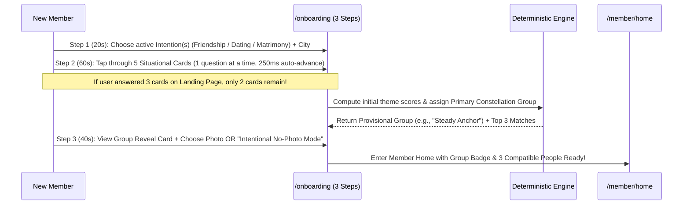

# 09 — LANDING PAGE, SIGN-IN & PROGRESSIVE ONBOARDING REDESIGN

## 1. Landing Page Audit & 5-Second Clarity Blueprint (`/`)

### What Current `src/` Gets Right (Keep)
- **Visual Identity:** The **Coromandel Indigo & Ochre** palette (`#F8F4EC` warm ivory, `#1F2F46` indigo, `#C9962E` ochre) and **Cormorant Garamond + DM Sans** pairing look like a high-trust editorial publication rather than a gamified swipe app.
- **Hero Artwork (`KithraWeave.tsx`):** The 3-strand Borromean **Kithra Weave** SVG with `motion/react` `pathLength` draw animation (`1.5s`, reduced-motion safe) satisfies Part A of the founder's earlier visual directive.
- **Hero Copy:** Eyebrow `CONNECTIONS WITH INTENTION`, Headline `Find your kind of people.`, and clear CTAs (`Get started`, `How it works`).

### What Must Be Improved Below the Fold on the Landing Page
1. **Add the 30-Second Interactive Personality Taste (From `Kithra-main-OLD-CONCEPT`):**
   - In `Kithra-main-OLD-CONCEPT` (`LandingPage.tsx`), visitors could answer **3 sample situational questions** and explore **Personality Archetypes** right on the landing page before creating an account.
   - Bringing back a clean **"Try 3 Questions in 30 Seconds"** interactive card directly below the hero lets a sceptical visitor *experience* how effortless Kithra's 1-tap questions feel and shows them their provisional **Personality Pattern Group** (`⚓ Steady Anchor`, `🌉 Warm Bridge`, `✦ Curious Spark`, etc.) immediately.
2. **Show the 8 Personality Pattern Groups Visually:**
   - Add a clean horizontal showcase of the **8 Kithra Personality Pattern Groups** so visitors immediately grasp: *"Oh! Kithra groups people by how they communicate, plan, and care for each other—not just by selfie swipes."*
3. **Keep the Interactive Relationship Map (`Echo` / `Counterpoint` / `Mosaic Fit`) Secondary & Plain-Language:**
   - Keep the interactive SVG line-linking diagram from Current `src/` in the "How Compatibility Works" section, but rename the tabs in plain everyday language:
     - **`Shared Ground (Echo)`** — *Where you naturally agree*
     - **`Healthy Balance (Counterpoint)`** — *Differences that keep life interesting without clashing on core values*
     - **`Teamwork Fit (Mosaic)`** — *How your everyday habits complement each other*

---

## 2. Hero Artwork Evaluation: The Kithra Weave vs. Interactive Relationship Map

Per Prompt Section 9, we evaluated the two visual metaphors across comprehension, emotional warmth, performance, and maintenance:

| Evaluation Criterion | **The Kithra Weave (`KithraWeave.tsx`) — Hero Position** | **Interactive SVG Line-Linking Relationship Map — Section 3 Position** |
|---|---|---|
| **5-Second Emotional & Brand Impression** | **9.5 / 10** — Pure, calm editorial artwork symbolizing three independent paths finding warm common ground without looking like a software flowchart. | **6.0 / 10** if placed in Hero — Looks like an interactive diagram/widget rather than a brand identity mark. |
| **Educational Clarity (Explaining Echo / Counterpoint / Mosaic)** | **5.0 / 10** — Symbolic rather than explanatory (by design). | **9.2 / 10** — Clicking two traits and seeing how they link as *Shared Ground* vs. *Teamwork Fit* makes deterministic matching tangible. |
| **Mobile Responsiveness (`360px`) & Performance** | **10 / 10** — Lightweight single SVG, zero layout shift, `1.5s` one-shot `pathLength` draw. | **8.5 / 10** — Works well as a focused interactive card lower on the page. |
| **Final Architectural Verdict** | **Keep `KithraWeave.tsx` in the Hero (Above the Fold).** | **Keep the Interactive Line-Linking Map in Section 3 ("How Compatibility Works") below the fold.** |

---

## 3. Recommended Above-the-Fold & Full Landing Page Structure

| Section Order | Section Title | Purpose & Interactive Mechanics | Primary CTA |
|---|---|---|---|
| **Section 1 (Above Fold)** | **Hero: Find your kind of people.** | Two-column layout: Left = Eyebrow, Headline, 3-Intention description (`Friendship`, `Dating`, `Matrimony`), `Get started` + `Try 3 sample questions`. Right = **The Kithra Weave** SVG (`KithraWeave.tsx`). | `Get started` |
| **Section 2** | **Interactive 30-Second Taste: How Do You Connect?** | Visitors tap through **3 real situational cards** (`Q1 -> Q2 -> Q3`, auto-advancing in `250ms`) and immediately see their provisional **Personality Pattern Group card** (*e.g., 🌉 The Warm Bridge*). Their 3 answers are saved in `localStorage` and carried into onboarding! | `Save my pattern & see matches` |
| **Section 3** | **Meet the 8 Personality Pattern Groups** | Visual filterable pills for *Steady Anchor*, *Warm Bridge*, *Curious Spark*, *Mosaic Builder*, *Deep Current*, *Horizon Planner*, *Calm Rhythm*, and *Circle Gatherer* showing each group's strengths and who they click with. | `Find your group` |
| **Section 4** | **One Account. Three Separate Rooms.** | Interactive switcher showing how **Friendship**, **Dating**, and **Matrimony** keep completely separate bios, photo visibility rules, and discovery pools. | `Explore intentions` |
| **Section 5** | **How Compatibility Works (Shared Ground, Healthy Balance & Teamwork)** | Interactive SVG comparison showing why Kithra looks at both **Shared Ground (`Echo`)** and **Teamwork Fit (`Mosaic`)** plus **4 Everyday Life Scenarios**. | `See a sample compatibility story` |
| **Section 6** | **Simple, Honest Membership (`₹0 / ₹149 / ₹249`)** | Transparent India-first pricing preview showing that 1 membership covers all 3 intentions, with 1-click cancellation and zero dark patterns. | `Start free today` |

---

## 4. Sign-In, Sign-Up & Session Recovery Redesign (`/signin`, `/join`)

### Friction Points in Current Auth Flows
- Switching between Sign-In, Sign-Up, and Demo Preview should take 1 click.
- Indian users strongly prefer **Phone/Email One-Time Code (OTP)** or **1-Tap Passkey / Google Sign-In** over remembering complex passwords.

### Recommended Clean Auth UX
1. **Single Focused Card (`max-width: 440px`) on Warm Ivory Canvas:**
   - Mode tabs at top: **`Sign in`** | **`Create account`**.
   - **Primary Input:** Email or Mobile Number -> **`Continue with 6-digit code`** (with option to use Password or Passkey).
   - **Instant Reviewer / Founder Shortcut Bar:** A subtle bottom bar offering **`One-Click Demo Member Sign-In (Kavya — 3 Intentions Active)`** and **`One-Click Staff Console Preview`** so testing never requires typing dummy credentials.
2. **Explicit Age & Intention Assurance on `/join`:**
   - Clear checkbox confirming `18+` (and statutory marriageable age `21+` / `18+` when activating `Matrimony`), plus a 1-line privacy promise: *"Your raw questionnaire answers are never public and never visible to staff."*

---

## 5. The 3-Minute Progressive Onboarding Redesign (`/onboarding`)

To eliminate onboarding drop-off while ensuring every new member immediately gets placed into a meaningful **Personality Pattern Group**, `/onboarding` is structured into **3 fast, rewarding steps**:

### Detailed Step-by-Step Onboarding Design
- **Step 1 — Where Would You Like to Start? (`20 seconds`):**
  - Select one, two, or all three intentions (`Friendship`, `Dating`, `Matrimony`).
  - Reassurance pill right below: *"Each intention is a separate room. People in Dating cannot see your Matrimony or Friendship profile unless they are also in that room."*
  - Basic Name & City selector.
- **Step 2 — Five Quick Situations (`60 seconds`):**
  - Displays **1 centered situational card at a time** (e.g., *Weekend rhythm*, *Disagreement repair*, *Decision style*, *Social battery*, *Core priority*).
  - If the user already answered 3 sample questions on the Landing Page, Step 2 greets them warmly: *"We saved your 3 answers from earlier! Answer just 2 more quick cards to unlock your Personality Pattern."*
  - Large touch targets (`min-height: 56px`), keyboard shortcuts `1–4`, `250ms` auto-advance, and a `Skip` link on every card.
- **Step 3 — Your Initial Pattern Reveal & Photo Choice (`40 seconds`):**
  - Displays a celebratory editorial card:
    - **`Your Initial Pattern: ⚓ The Steady Anchor`** *(with a **Warm Bridge** undertone)*
    - 2 bullet points describing their natural strengths.
  - **Photo Choice (Zero Pressure):**
    - **Option 1:** Upload & frame a `4:5` portrait right now.
    - **Option 2 (First-Class Citizen):** Toggle **`Start in Personality-First (No-Photo) Mode`** — *"Show your Steady Anchor constellation monogram in Discovery and reveal photos only after you accept a connection."*
  - Primary CTA: **`Meet people who fit my pattern ->`** (opens `/member/home` or `/member/discover`).

