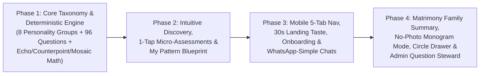

# 15 — IMPLEMENTATION PRIORITY, ARCHITECTURE PLAN & DEPENDENCIES

## 1. Engineering Strategy: Evolution, Never Destructive Rewrite

The current application in [`c:\Users\hp\Desktop\Kithra\src\`](file:///c:/Users/hp/Desktop/Kithra/src/) already has a clean, working foundation:
- **Approved Visual Identity:** Coromandel Indigo & Ochre tokens + Cormorant Garamond & DM Sans in [`src/index.css`](file:///c:/Users/hp/Desktop/Kithra/src/index.css).
- **Approved Hero Artwork:** **The Kithra Weave** (`KithraWeave.tsx`) with `motion/react` `pathLength` draw animation.
- **Approved AppShell:** Collapsible desktop sidebar (`248px` / `72px`) with `localStorage` persistence in [`src/components/AppShell.tsx`](file:///c:/Users/hp/Desktop/Kithra/src/components/AppShell.tsx).
- **Rich Studio Components:** Interactive `4:5` `PhotoManager` ([`src/components/PhotoManager.tsx`](file:///c:/Users/hp/Desktop/Kithra/src/components/PhotoManager.tsx)), Admin Console routes ([`src/pages/AdminPages.tsx`](file:///c:/Users/hp/Desktop/Kithra/src/pages/AdminPages.tsx)), and System Lifecycle states ([`src/pages/SystemStatesView.tsx`](file:///c:/Users/hp/Desktop/Kithra/src/pages/SystemStatesView.tsx)).

Our implementation plan **preserves 100% of these strengths** while systematically layering in the intuitive UX patterns from `Kithra-main-OLD-CONCEPT.zip` and the deterministic engine from `Kithra-3rd` across **4 structured phases**.

---

## 2. Four-Phase Implementation Roadmap (Once Approved by Founder)

### Phase 1 — Core Taxonomy, 8 Personality Pattern Groups & Deterministic Scoring Engine
- **Goal:** Establish the clean data and domain foundation so personality grouping and question scoring are 100% real and deterministic in the frontend state.
- **Files to Create / Update:**
  1. `src/domain/personalityGroups.ts`:
     - Define the **8 Kithra Personality Pattern Groups (Constellations)** (`Steady Anchor`, `Warm Bridge`, `Curious Spark`, `Mosaic Builder`, `Deep Current`, `Horizon Planner`, `Calm Rhythm`, `Circle Gatherer`) with icons, plain-language descriptions, natural strengths, and deterministic assignment math from theme scores.
  2. `src/domain/matching.ts` (Ported & Refined from `Kithra-3rd/src/domain/matching.ts`):
     - Pure deterministic functions for **Shared Ground (`Echo`)**, **Healthy Balance (`Counterpoint`)**, **Teamwork Fit (`Mosaic`)**, the **4 Everyday Life Scenarios** (`DETERMINISTIC_SCENARIOS`), and the `>=50%` coverage gate.
  3. `src/data/kithraQuestions.ts` (Merged from `Kithra-main-OLD-CONCEPT/src/data/questions.ts` + 12 Canonical Themes):
     - Import the rich situational questions from `Kithra-main-OLD-CONCEPT` organized cleanly into **12 Relatable Life Chapters** (broken into effortless **5-question micro-sprints**), with plain-language *"Why this question matters"* notes.
- **Verification Gate:** Unit tests in `src/test/matching.test.ts` verifying deterministic group assignment, Echo/Counterpoint/Mosaic calculation, and scenario generation.

### Phase 2 — Intuitive Discovery Folders, "My Pattern" Blueprint & 1-Question Auto-Advancing Micro-Sprints
- **Goal:** Deliver the signature UX improvements the founder requested—grouping people into understandable personality types and making questions effortless and rewarding to answer.
- **Files to Update:**
  1. [`src/pages/MemberPages.tsx`](file:///c:/Users/hp/Desktop/Kithra/src/pages/MemberPages.tsx) — **Discover (`/member/discover`):**
     - Add the **Left Folder Rail (Desktop) / Horizontal Category Bubbles (Mobile)** to browse by **All Compatible**, **8 Personality Pattern Groups**, **Compatibility Lens** (`Shared Ground`, `Healthy Balance`, `Teamwork Fit`), and **Saved Shortlists**.
     - Simplify profile cards to the **3-Second Scan** rule (Portrait/Monogram, Name/City, **Personality Group Pill**, **1-sentence human fit summary**, and `View Compatibility Story`).
     - Restore the **2-Candidate Side-by-Side Comparison Modal** from `Kithra-main-OLD-CONCEPT`.
  2. [`src/pages/MemberPages.tsx`](file:///c:/Users/hp/Desktop/Kithra/src/pages/MemberPages.tsx) — **Match Story (`/member/match/:id`):**
     - Upgrade to show the **Pairing Headline** (*e.g., Steady Anchor × Warm Bridge*), the **2-Box Core Story** (*Where You Click* + *How You Balance Each Other*), the **4 Interactive Everyday Scenario Cards**, and the collapsible *"See full theme-by-theme alignment"* drawer.
  3. [`src/pages/MemberPages.tsx`](file:///c:/Users/hp/Desktop/Kithra/src/pages/MemberPages.tsx) — **My Pattern (`/member/self` & `/member/assessments`):**
     - Build the 3-tab Self-Discovery hub:
       - **Tab 1 (`My Personality Story`):** Your Constellation badge, strengths, communication & conflict repair style, blind spots, and which Personality Groups balance you best.
       - **Tab 2 (`60-Second Question Decks`):** 12 Life Chapter cards -> Click to launch the **1-Question-at-a-Time Auto-Advancing Sprint Modal** (`250ms` auto-advance, `1–4` hotkeys, instant 5-card insight unlock).
       - **Tab 3 (`Private Reflection Journal`):** Restored from `Kithra-main-OLD-CONCEPT`'s `JournalView.tsx`.

### Phase 3 — Mobile 5-Tab Bar, 30-Second Landing Taste, 3-Minute Onboarding & Messaging Upgrade
- **Goal:** Make the entry experience and daily navigation feel as natural as Instagram, WhatsApp, and Swiggy.
- **Files to Update:**
  1. [`src/components/AppShell.tsx`](file:///c:/Users/hp/Desktop/Kithra/src/components/AppShell.tsx):
     - Keep the collapsible desktop sidebar (`248px` / `72px`) and add the **Persistent 5-Tab Mobile Bottom Bar** (`Home`, `Discover`, `My Pattern`, `Circles`, `Chats`) on `<768px` screens.
     - Add `Cmd+K` / `Ctrl+K` quick jump palette support.
  2. [`src/pages/PublicPages.tsx`](file:///c:/Users/hp/Desktop/Kithra/src/pages/PublicPages.tsx):
     - Keep `KithraHero` + `KithraWeave` above the fold.
     - Add the **Interactive 3-Question Taste ("Try 3 Questions in 30 Seconds")** and **8 Personality Pattern Group Showcase** below the fold, saving the visitor's 3 answers into `localStorage`.
     - Update `/onboarding` to the **3-Step Progressive Onboarding** (Intention -> 5 Quick Cards -> Instant Personality Group Reveal + Photo / No-Photo choice).
  3. [`src/pages/MemberPages.tsx`](file:///c:/Users/hp/Desktop/Kithra/src/pages/MemberPages.tsx) — **Home (`/member/home`) & Messages (`/member/messages`):**
     - Add the **Today's 60-Second Reflection** inline card on `/member/home`.
     - Add **`Active Chats` vs. `Intro Requests`** filter tabs, **3 Clickable Trait Icebreaker Chips**, and the collapsible **Right-Hand Match Summary Pane** in `/member/messages`.

### Phase 4 — Intentional No-Photo Monogram Mode, Matrimony Family Summary, Circle Detail Drawer & Admin Question Steward
- **Goal:** Complete all high-trust cultural, community, billing, and operational requirements.
- **Files to Update:**
  1. **Intentional No-Photo Mode (`/member/photos` & Discovery Cards):**
     - Render an editorial **Personality Constellation Monogram** when a member selects *"Reveal photos only after mutual connect"*.
  2. **Matrimony Read-Only Family Summary Link (`/member/match/:id` & `/member/profile`):**
     - Drawer to generate, customize, preview, copy, and 1-click revoke a family-safe summary card.
  3. **Circle Detail Drawer (`/member/circles`) & Member Membership Tab (`/member/membership`):**
     - Open any Circle to see members (with their Personality Group badges), reply to the weekly prompt, and RSVP to gatherings.
     - Add self-serve plan management (`Free ₹0` / `Plus ₹149` / `Connect ₹249`) with 1-click cancellation.
  4. **Admin Question & Scoring Steward (`/admin/questions` in [`src/pages/AdminPages.tsx`](file:///c:/Users/hp/Desktop/Kithra/src/pages/AdminPages.tsx)):**
     - Add the Question Bank & Personality Group Steward tab + 15-minute JIT reason prompt in `/admin/reports`.

---

## 3. External & Production Dependencies Register (`DEP-01` through `DEP-08`)

To maintain strict honesty between what runs in the interactive frontend vs. what requires external production credentials later:

| Dependency ID | Scope | Frontend / Local Status | Production Backend Requirement |
|---|---|---|---|
| `DEP-01` | **Questionnaire Item Bank** | **96+ situational questions** across 12 chapters live in local TypeScript data; supports full interactive scoring | Expand to full 2,400 item rows in PostgreSQL/D1 (`12 themes × Set A/B × 100 items`) over subsequent content releases |
| `DEP-02` | **Authentication & Passkeys** | Interactive OTP / Passkey / Demo session flow persisted in `localStorage` | Connect production OAuth / WebAuthn / SMS OTP gateway |
| `DEP-03` | **Photo Processing & Storage** | Real local file picker (`URL.createObjectURL`), interactive `4:5` crop/zoom/rotate, and client-side EXIF scrub preview | Connect Cloudflare R2 / S3 signed upload pipeline + server-side `sharp`/`libvips` EXIF stripping |
| `DEP-04` | **Payment Gateway (`Plus` / `Connect`)** | Full interactive plan selector, cycle calculator, invoice preview, and 1-click cancellation state | Connect Razorpay (UPI AutoPay / Cards for India) and Stripe (International) webhooks |
| `DEP-05` | **Live Identity Verification (`₹99` Add-On)** | Verification badge states (`Verified`, `Pending`, `Unverified`) modeled in UI | Connect DigiLocker / licensed KYC verification webhook |
| `DEP-06` | **Staff Hardware MFA & RBAC Enforcement** | Explicit security notice banner on `/admin/login` + interactive 10-role RBAC filter & hash-chain audit log | Enforce server-side JWT role claims + hardware WebAuthn key verification at API gateway |

