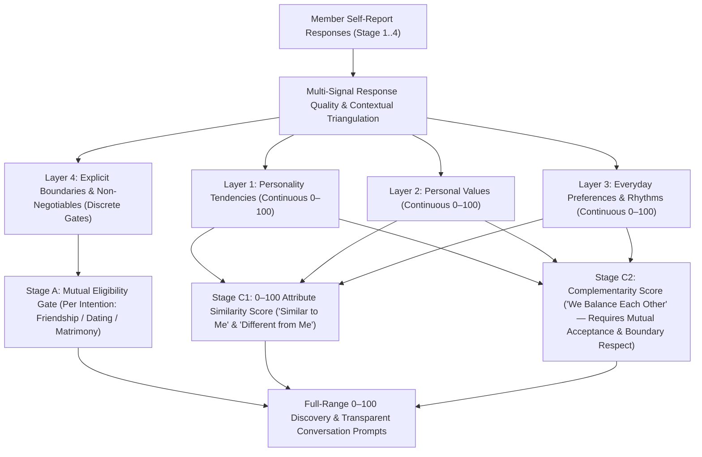

# 01 — SCIENTIFIC LITERATURE REVIEW & KITHRA THEORETICAL MODEL

## 1. Scientific Literature & Standards Review (Deliverable 1)

Every design decision in Kithra's psychological engine is grounded in established psychometric, relationship-science, and test-standards literature. No fake citations or unverified claims are permitted.

### 1.1 Personality Structure & Open-Source Psychometric Foundations
- **Goldberg, L. R. (1999).** *A broad-bandwidth, public domain, personality inventory measuring the lower-level facets of several five-factor models.* In I. Mervielde et al. (Eds.), *Personality Psychology in Europe* (Vol. 7, pp. 7–28). Tilburg University Press. (Foundation of the **International Personality Item Pool — IPIP**).
- **Goldberg, L. R., Johnson, J. A., Eber, H. W., Hogan, R., Ashton, M. C., Cloninger, C. R., & Gough, H. G. (2006).** *The international personality item pool and the future of public-domain personality measures.* Journal of Research in Personality, 40(1), 84–96.
- **Soto, C. J., & John, O. P. (2017).** *The next Big Five Inventory (BFI-2): Developing and assessing a hierarchical model with 15 facets to enhance bandwidth, fidelity, and predictive power.* Journal of Personality and Social Psychology, 113(1), 117–143.
- **Ashton, M. C., & Lee, K. (2007).** *Empirical, theoretical, and practical advantages of the HEXACO model of personality structure.* Personality and Social Psychology Review, 11(2), 150–166.

**Application to Kithra:** Continuous dimensions provide far higher reliability and construct validity than rigid typologies. Kithra writes **100% original, everyday India-contextualized items** (`ORIGINAL / UNVALIDATED` until pilot calibration) inspired by open public-domain construct definitions rather than copying proprietary instruments (NEO-PI-R, MBTI, CliftonStrengths, Attachment Style questionnaires, Gottman questionnaires).

### 1.2 Personal Values & Cross-Cultural Structure
- **Schwartz, S. H. (1992).** *Universals in the content and structure of values: Theoretical advances and empirical tests in 20 countries.* Advances in Experimental Social Psychology, 25, 1–65.
- **Schwartz, S. H., Cieciuch, J., Vecchione, M., Davidov, E., Fischer, R., Beierlein, C., ... & Konty, M. (2012).** *Refining the theory of basic individual values.* Journal of Personality and Social Psychology, 103(4), 663–688.

**Application to Kithra:** Personal values (e.g., autonomy vs. interwoven family traditions, financial stewardship vs. experiential spending, egalitarian domestic partnership) are distinct from personality traits. Two people can differ in social energy (personality) while sharing deep alignment on honesty, conflict repair, and family boundaries (values).

### 1.3 Relationship Science & Realistic Limits of Matching Algorithms
- **Finkel, E. J., Eastwick, P. W., Karney, B. R., Reis, H. T., & Sprecher, S. (2012).** *Online dating: A critical analysis from the perspective of psychological science.* Psychological Science in the Public Interest, 13(1), 3–66.
- **Joel, S., Eastwick, P. W., & Finkel, E. J. (2017).** *Is romantic desire predictable? Machine learning applied to initial romantic attraction.* Psychological Science, 28(10), 1478–1489.
- **Joel, S., Eastwick, P. W., Allison, C. J., Arriaga, X. B., Baker, Z. G., Bar-Kalifa, E., ... & Wolf, S. (2020).** *Machine learning uncovers the most robust self-report predictors of relationship quality across 43 longitudinal couples studies.* Proceedings of the National Academy of Sciences (PNAS), 117(32), 19061–19071.
- **Karney, B. R., & Bradbury, T. N. (1995).** *The longitudinal course of marital quality and stability: A review of theory, method, and research.* Psychological Bulletin, 118(1), 3–34.

**Application to Kithra:**
1. **No False "Soulmate %" Promises:** Finkel et al. (2012) and Joel et al. (2017, 2020) demonstrate that pre-interaction self-report similarity cannot deterministically predict chemistry or long-term relationship destiny, whereas relationship-specific interaction processes (responsiveness, conflict repair, perceived commitment, emotional steadiness) matter deeply.
2. **Full `0–100` Similarity Agency:** Because people form meaningful friendships, dates, and partnerships across a wide range of trait similarity, Kithra never secretly eliminates eligible members with low similarity scores (`5/100` or `25/100`). Instead, Kithra exposes the full `0–100` Attribute Similarity spectrum alongside `Similar to Me`, `Different from Me`, and `We Balance Each Other` lenses.

### 1.4 Situational Variation & Person–Situation Interaction
- **Mischel, W., & Shoda, Y. (1995).** *A cognitive-affective system theory of personality: Reconceptualizing situations, dispositions, dynamics, and invariance in personality structure.* Psychological Review, 102(2), 246–268.
- **Fleeson, W. (2001).** *Toward a structure- and process-integrated view of personality: Traits as density distributions of states.* Journal of Personality and Social Psychology, 80(6), 1011–1027.

**Application to Kithra:** Human behavior is context-dependent (*"if ... then ..."* behavioral signatures). Enjoying a lively festival with close friends while needing quiet solitude after an exhausting workweek is **normal situational variation** (`plausible_situational_variation`), never "dishonesty."

### 1.5 Careless Responding, Forced-Choice & Testing Standards
- **Meade, A. W., & Craig, S. B. (2012).** *Identifying careless responses in survey data.* Psychological Methods, 17(3), 437–455.
- **Curran, P. G. (2016).** *Methods for the detection of carelessly invalid responses in survey data.* Journal of Experimental Social Psychology, 66, 4–19.
- **Paulhus, D. L. (1991).** *Measurement and control of response bias.* In J. P. Robinson, P. R. Shaver, & L. S. Wrightsman (Eds.), *Measures of Personality and Social Psychological Attitudes* (pp. 17–59). Academic Press.
- **Brown, A., & Maydeu-Olivares, A. (2011).** *Item response modeling of forced-choice questionnaires.* Educational and Psychological Measurement, 71(3), 460–502.
- **AERA, APA, & NCME (2014).** *Standards for Educational and Psychological Testing.* American Educational Research Association, American Psychological Association, and National Council on Measurement in Education.

---

## 2. Kithra Psychological Theoretical Model (Deliverable 2)

### Five Strictly Separated Concepts
| Concept | What It Represents | How Kithra Models It | How It Affects Discovery |
|---|---|---|---|
| **1. Personality** | Dispositional tendencies (curiosity, planfulness, social energy, emotional steadiness) | Continuous `0–100` construct scores with confidence weights | Contributes to `0–100` Attribute Similarity and Stage 2+ experimental pattern summaries |
| **2. Values** | Guiding principles (repair kindness, honesty, egalitarian household, family autonomy) | Continuous `0–100` construct scores + importance weight | Weighted more heavily in `dating` and `matrimony` similarity and shared-ground notes |
| **3. Preferences** | Everyday habits and rhythms (evening vs. morning energy, reply cadence, Sunday restoration) | Continuous `0–100` construct scores + flexibility rating (`0–100`) | Drives `Similar to Me`, `Different from Me`, and `We Balance Each Other` conversation starters |
| **4. Boundaries & Non-Negotiables** | Hard requirements (adult status, active intention, block list, `exclusive_required` vs `open_required`, essential children goals) | Discrete categorical states (`unknown` preserved as `unknown`) | Evaluated in **Stage A Mutual Eligibility** before any similarity or complementarity scoring |
| **5. Compatibility** | Multi-dimensional interaction between two eligible members in a specific intention | Separate outputs: Stage A Eligibility + `0–100` Attribute Similarity + `We Balance Each Other` Complementarity | Displayed transparently on cards and Match Details without claiming a single "soulmate %" |

