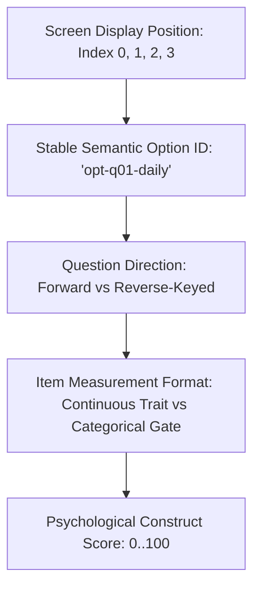
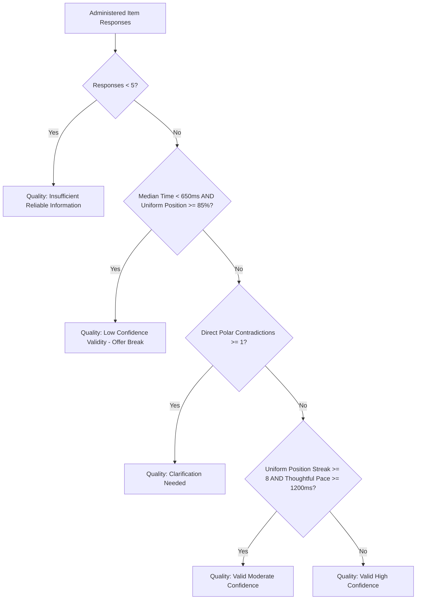

# KITHRA — FAIR RESPONSE-QUALITY SAFEGUARD ENGINE

**Document Reference:** `KITHRA_RESPONSE_QUALITY_SAFEGUARDS.md`  
**Founder Directive:** *"Option B or C is just a screen position. It is not a psychological value. Distinguish displayed option index from stable semantic response ID. Never use response speed as a measurement of moral character."*  
**Implementation:** `evaluateResponseQuality()` in `src/domain/psychologyEngine.ts`  
**Status:** Staging Specification (November 2026)

---

## 1. THE FIVE DISTINCT RESPONSE LAYERS

A common psychometric blunder in amateur web assessments is treating screen interaction coordinates as psychological traits. Kithra enforces strict separation across five independent architectural layers:



1. **Displayed Option Index:** Visual 0-based index on the glass (0 = Option A, 1 = Option B, 2 = Option C, 3 = Option D). Varies across devices and randomized presentation orders.
2. **Stable Semantic Option ID:** Universal immutable identifier (e.g., `opt-q01-daily-checkin`) that retains its meaning regardless of visual position.
3. **Item Type & Format:** Distinguishes situational judgment tests, continuous rating scales, values tradeoffs, and discrete categorical gates.
4. **Question Direction:** Accounts for whether an item is direct-keyed or reverse-keyed ($x_{\text{norm}} = 100 - x_{\text{raw}}$).
5. **Semantic Meaning:** The actual psychological stance endorsed by the member.

---

## 2. OPTION SHUFFLING INTEGRITY: RULES & SAFEGUARDS

### A. When Shuffling is Permitted
- **Unordered Categorical Scenarios:** Scenarios presenting non-hierarchical situational choices (e.g., "Take a 30-minute pause", "Write a text note", "Suggest a phone call"). Shuffling prevents visual position bias (primacy and recency effects).
- **Deterministic Seeding:** Shuffled options are seeded deterministically using `shuffleQuestionOptionsDeterministically(options, seed)` where `seed = 'session-' + memberId + '-' + questionId`. This guarantees that if a member refreshes their browser, the options appear in the exact same order for that sitting.

### B. When Shuffling is Strictly Prohibited
- **Inherently Ordered Rating Scales:** Likert scales (e.g., *Strongly Disagree $\to$ Disagree $\to$ Neutral $\to$ Agree $\to$ Strongly Agree*) and ordinal frequency scales (e.g., *Never $\to$ Occasionally $\to$ Frequently $\to$ Daily*) **MUST NEVER** have their options shuffled out of order. Scrambling ordered rating anchors disorients respondents, induces cognitive confusion, and invalidates psychometric construct validity.

### C. Mathematical Invariance
The scoring function `scoreShuffledResponseOption()` maps visual clicks directly back to the underlying `semanticOptionId`. Regardless of whether an option appears as visual Button 1 or Button 4:
$$\text{Score}(\text{Option}_k) \equiv \text{Invariant across all permutations } \sigma \in S_n$$

---

## 3. MULTI-SIGNAL INTEGRITY ENGINE: BEHAVIORAL PATTERNS

The response-quality engine rejects simplistic single-metric triggers. It requires **converging behavioral signals** evaluated through human reading science:



### Pattern A: Repeated Visual Position (e.g., 20 Consecutive Option B Clicks)
- **Behavior:** Member selects visual Option B repeatedly across 20 questions.
- **Timing:** Thoughtful reading pace ($\text{median} \ge 1,200\,\text{ms}$).
- **Analysis:** A member who genuinely values collaboration, moderation, or compromise may authentically align with Option B across multiple items. Because their response time indicates deliberate reading, Kithra protects them.
- **System Action:** Evaluates as `valid_moderate_confidence` or `valid_high_confidence`. Zero accusations of dishonesty. Zero account suspension.

### Pattern B: Alternating Positions (e.g., B $\to$ C $\to$ B $\to$ C)
- **Behavior:** Member clicks alternating visual positions $[1, 2, 1, 2, 1, 2]$.
- **Timing & Semantics:** Reading pace is deliberate, and the actual semantic options chosen represent coherent personal preferences.
- **Analysis:** Screen position is an artifact of layout. Coherent semantic choices cannot be dismissed merely because visual positions formed an alternating pattern.
- **System Action:** Evaluated as valid. Zero penalty.

### Pattern C: Thoughtful Fast Readers
- **Behavior:** Member answers quickly ($650\,\text{ms} \le \text{median} < 1,200\,\text{ms}$) with varied visual positions and coherent semantic choices across diverse constructs.
- **Research Basis:** Human silent reading speeds for experienced adults frequently reach 250–350 words per minute (Rayner, 1998). A concise 15-word scenario prompt can be comprehended in under 800ms by an attentive reader.
- **System Action:** Evaluates as `valid_high_confidence`. Zero penalty.

### Pattern D: Low-Literacy, Multilingual, or Screen-Reader Assistive Users
- **Behavior:** Member takes $15,000\,\text{ms} - 35,000\,\text{ms}$ per question.
- **Analysis:** High latency reflects careful reading, regional language translation comprehension (Tamil / Hindi), or text-to-speech audio rendering.
- **System Action:** Slow response speed is **NEVER** flagged as low quality, careless, or suspicious. Evaluates as `valid_high_confidence`.

### Pattern E: Ultra-Fast Uniform Clicking (The True Careless Responder)
- **Behavior:** Median response time $< 650\,\text{ms}$ combined with visual position streak $\ge 8$ or uniform position ratio $\ge 85\%$.
- **Research Basis:** Physical perception-reaction time plus silent reading of 20+ words requires a physiological minimum of 650ms. Clicking 10 questions in 3 seconds indicates non-reading random tapping.
- **System Action:** Evaluates as `low_confidence_validity`. Emits a minimal telemetry event for administrative trend monitoring. Presents a calm, non-accusatory member prompt:
  > *"We noticed that some of your responses were completed very quickly. You can take a break, review your answers, or resume whenever you're ready."*
- **Absolute Privacy Invariant:** Never suspends the account. Never accuses the user of deception.

---

## 4. ADMINISTRATIVE TELEMETRY PRIVACY INVARIANT

Under Section 12 of the Digital Personal Data Protection (DPDP) Act 2023, personal questionnaire responses are confidential private reflections. When a response-quality review event is logged for operational analytics, raw answers are strictly stripped:

```json
{
  "eventType": "assessment_quality_review_recommended",
  "sessionReference": "sess-member-kavya",
  "assessmentVersion": "2026.11-psych-v2.0-deterministic",
  "broadCategory": "rapid_completion_and_uniform_pattern",
  "timestamp": "2026-11-03T12:00:00.000Z",
  "reviewStatus": "pending_optional_member_retry",
  "rawAnswersIncluded": false
}
```

Support staff, photo reviewers, and community moderators receive **HTTP 403 Forbidden** if attempting to inspect raw questionnaire choices. Telemetry records only aggregate operational metadata.

