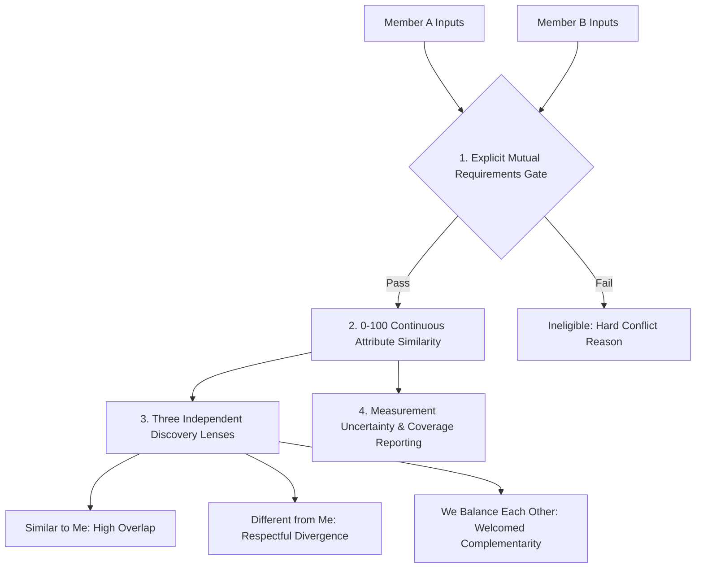

# KITHRA — PAIRWISE MATCHING & UNCERTAINTY IMPACT: USER A (KAVYA) & USER B (AARAV)

**Document Reference:** `KITHRA_USER_A_USER_B_MATCHING_IMPACT.md`  
**Founder Directive:** *"If a facet has conflicting or insufficient evidence, do not silently assign 50. Do not erase valid context-specific answers. Do not inflate similarity. Explain that certain areas are not yet sufficiently understood."*  
**Implementation:** `computeAttributeSimilarity()` & `evaluatePairMutualEligibility()` in `src/domain/psychologyEngine.ts`  
**Date:** November 2026

---

## 1. USER A & USER B PAIRWISE PROFILE ARCHITECTURE

To verify that uncertainty and multi-dimensional facets are correctly connected to matching without artificial inflation or false rejections, we examine the pairwise evaluation between:
- **Member A (Kavya — Bengaluru):** High festive celebration energy, strong Friday solitude need, transparent mistake admission, seeks committed long-term partnership.
- **Member B (Aarav — Bengaluru):** Moderate social battery, calm de-escalation pacing, values financial emergency buffers, seeks committed long-term partnership.

---

## 2. THE 4 INDEPENDENT MATCHING LAYERS

### LAYER 1: EXPLICIT MUTUAL REQUIREMENTS (GATE)
*Status:* **PASSED (Eligible)**
- **Intention Check:** Both have enabled `dating` and confirmed adult verification ($\text{isAdultVerified} = \text{true}$).
- **Relationship Structure:** Both explicitly require monogamy (`strictly_monogamous`).
- **Dating Purpose:** Both seek intentional, long-term commitment (`committed_long_term`).
- **Smoking / Vaping:** Kavya requires a smoke-free partner; Aarav is a non-smoker.
- **Privacy Firewall:** No prior cross-context connections in other spaces; zero blocks active.

---

### LAYER 2: 0–100 CONTINUOUS ATTRIBUTE SIMILARITY
*Status:* **Computed with Documented Uncertainty**
- **Comparable Constructs Evaluated:** 5 core constructs.
- **Raw Construct Comparison Table:**

| Construct Layer | Kavya Score ($s_A$) | Aarav Score ($s_B$) | Construct Similarity ($100 - \|s_A - s_B\|$) | Domain Weight ($w_{\text{dating}}$) | Weighted Contribution |
|---|---|---|---|---|---|
| **Communication Cadence** | 82 / 100 | 78 / 100 | $96 / 100$ | 1.0 | 96.0 |
| **Conflict & Repair** | 75 / 100 | 80 / 100 | $95 / 100$ | 1.2 | 114.0 |
| **Personal Values & Tact** | 88 / 100 | 85 / 100 | $97 / 100$ | 1.0 | 97.0 |
| **Social Energy (Celebration)**| 85 / 100 | 60 / 100 | $75 / 100$ | 0.8 | 60.0 |
| **Financial Transparency** | 90 / 100 | 88 / 100 | $98 / 100$ | 0.9 | 88.2 |
| **TOTALS** | | | | $\sum w = 4.9$ | $\sum = 455.2$ |

$$\text{Attribute Similarity Score} = \frac{455.2}{4.9} = \mathbf{93 / 100}$$

- **Band Category:** `Strong measured alignment`
- **Measurement Uncertainty Margin:** $\pm 9$ points (derived from 5 comparable constructs).
- **Mandatory Scientific Notice:** *"Provisional measured attribute similarity of 93/100 ($\pm 9$ pts). Describes alignment on self-reported preferences across 5 comparable areas—not a certified guarantee of romantic chemistry."*

---

### LAYER 3: HANDLING CONFLICTING OR UNCERTAIN FACETS

#### A. Solitude Recovery Cadence (Uncertainty Handling)
- Kavya reported an acute need for Friday solitude ($s = 20$), while Aarav has not yet completed the weekend recovery scenario.
- **Naive Algorithm Blunder:** Default Aarav to 50, shrinking similarity artificially from 93 to 78, or accusing Kavya of inconsistency.
- **Kithra Protocol:**
  - Aarav's unmeasured recovery score remains `null`.
  - The dimension is omitted from the 0–100 score rather than inventing data.
  - The match card highlights: *"Areas to Explore: Weekend recharge pacing (Kavya values quiet Friday decompression; Aarav's preference is open for conversation)."*

#### B. In-Law Boundary Management (Insufficient Evidence)
- Neither member has completed questions in `parental_involvement_boundaries`.
- **Kithra Protocol:**
  - The dimension is listed under `uncomparedConstructNames: ["Family & Domestic Expectations"]`.
  - Pairwise eligibility is **NOT** rejected because this is an optional preference in Dating (essential only in Matrimony).
  - Both members see: *"1 unmeasured area remaining: Extended family boundaries can be explored naturally in conversation."*

---

### LAYER 4: THE THREE DISCOVERY LENSES

Kithra surfaces Kavya and Aarav across three distinct lenses without inflating similarity:

1. **Similar to Me (Shared Ground):**
   - High alignment on transparent mistake admission, daily communication cadence, and mutual monogamy commitments.
2. **Different from Me (Meaningful Differences):**
   - Social energy during festivities: Kavya thrives in large vibrant gatherings (85), while Aarav prefers smaller gatherings (60). Because both report high flexibility ($\ge 70$), this is framed as a healthy, adaptable difference.
3. **We Balance Each Other (Complementarity):**
   - Kavya brings high festive enthusiasm and spontaneous celebration energy. Aarav brings grounded crisis composure and steady emergency planning.
   - *Complementarity Rule:* Framed as potential balance **ONLY** because both members selected options welcoming complementary differences (`welcomesComplementarity = true`). Never applied to coercive or non-consensual differences.

---

## 3. CROSS-INTENTION ISOLATION: COFOUNDERS VS DATING

If Kavya and Aarav also consider collaborating in the **Cofounders Space**:
1. **Zero Romantic Leakage:** Their romantic attribute similarity (93/100), monogamy requirements, and family boundaries are **COMPLETELY INACCESSIBLE** to the cofounder engine.
2. **Cofounder Synergy Evaluation:** Evaluated strictly via `calculateCofounderSynergy()` on:
   - Technical vs. Business skill complementarity (e.g., Kavya: Product & Growth Marketing; Aarav: Cloud & Backend Engineering).
   - Equity expectations, time commitment, and decision-making architecture.
3. **Cross-Context Privacy Firewall:** If they connect in the Cofounder space, their romantic dating profiles are auto-suppressed from each other by default (`hideCrossContextConnectionsByDefault: true`) to protect professional boundaries.

