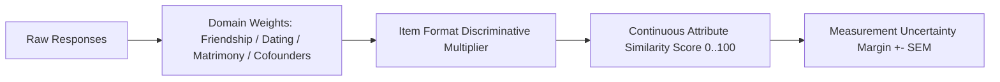

# KITHRA — EVIDENCE WEIGHTING, UNCERTAINTY MODELING & PSYCHOMETRIC RESEARCH (APPROACHES A–D)

**Document Reference:** `KITHRA_WEIGHTING_AND_UNCERTAINTY_RESEARCH.md`  
**Founder Directive:** *"Do not invent precision by assigning arbitrary weights that appear scientific. Do not train a neural network on synthetic personalities and claim real psychological accuracy. Implement Approach A correctly now; design B–D as research paths."*  
**Date:** November 2026

---

## 1. EVIDENCE AGGREGATION & WEIGHTING SPECIFICATION (TASK 6)

In psychological measurement, assigning arbitrary decimal weights (e.g., $w_1 = 0.8732$) before empirical calibration is a form of pseudo-scientific theater. Kithra enforces transparent, versioned rules:

### Domain Weight Matrices by Intention
Weights reflect the structural relevance of constructs to each specific life intention:

$$\text{Attribute Similarity} = \frac{\sum_{c \in C_{\text{comparable}}} (100 - |s_{v,c} - s_{c,c}|) \cdot w_{\text{intention},c}}{\sum_{c \in C_{\text{comparable}}} w_{\text{intention},c}}$$

1. **Friendship Space:** High weight on `communication`, `intellectual_curiosity`, and `daily_lifestyle`. Zero weight on domestic labor or children goals.
2. **Dating Space:** Balanced weight on `communication`, `conflict_repair`, `relational_boundaries`, and `romantic_expectations`.
3. **Matrimony Space:** Elevated weight on `family_domestic`, `finances_independence`, `conflict_repair`, and long-term values alignment.
4. **Cofounders Beta Space:** Evaluated exclusively on startup execution, complementary skill coverage, and decision architecture via `cofounderSynergyEngine.ts`. Personality dimensions are strictly isolated.

---

## 2. THE 4 PSYCHOMETRIC APPROACHES: COMPARATIVE EVALUATION (TASK 9)

| Dimension | Approach A: Transparent Rule-Based (Current Production) | Approach B: Calibrated Psychometrics (IRT / GRM) | Approach C: Bayesian Adaptive CAT | Approach D: Machine Learning / Deep Neural Nets |
|---|---|---|---|---|
| **Underlying Math** | Deterministic bounded linear scoring with facet triangulation | 2-Parameter Logistic (2PL) / Samejima Graded Response Model (GRM) | Maximum Fisher Information / Kullback-Leibler posterior variance reduction | Latent transformer embeddings / Contrastive representation learning |
| **Data Requirements** | Zero historical data required; expert cognitive validity | Consented human pilot data ($N \ge 300$ per item anchor) | Calibrated item parameters ($a_i$ discrimination, $b_i$ difficulty) | Large-scale longitudinal outcome data ($N \ge 10,000$ couples/pairs) |
| **Explainability** | **100% Traceable**; plain-English item and facet lineage | High; parameters explain item curve and precision | Moderate; mathematical information gain traceable | Low / Black-box; risk of unexplainable latent correlations |
| **Risk of Overclaiming** | **Zero**; explicitly marked provisional heuristic | Low; standard errors of measurement mathematically bounded | Low; posterior credibility intervals reported | **High**; synthetic training creates hallucinations of certainty |
| **Ethical & Legal Audit** | Full compliance with DPDP Act 2023 & ITC Guidelines | Complies with ITC Guidelines for computerized testing | Complies with ITC CAT standards | Regulatory risk of automated profiling without explanation |
| **Implementation Recommendation** | **APPROVED FOR PRODUCTION NOW** | **RESEARCH STAGE B (Post-Pilot)** | **RESEARCH STAGE C (Post-N=500 Pilot)** | **RESEARCH BENCHMARK ONLY (Never on synthetic data)** |

---

## 3. IN-DEPTH TECHNICAL ANALYSIS OF APPROACHES B, C & D

### APPROACH B — CALIBRATED PSYCHOMETRIC MODEL (ITEM RESPONSE THEORY)

Item Response Theory (IRT) models the probability of endorsing an option as a function of the underlying latent trait $\theta$:

$$P(X_i = k \mid \theta) = \frac{1}{1 + e^{-a_i (\theta - b_{i,k})}} - \frac{1}{1 + e^{-a_i (\theta - b_{i,k+1})}}$$

Where:
- $\theta$: Latent construct score of the member (standardized $\mathcal{N}(0, 1)$).
- $a_i$: Item discrimination parameter (how sharply the question separates different levels of the trait).
- $b_{i,k}$: Threshold difficulty parameter for option category $k$.

*Prerequisite for Kithra Adoption:* IRT cannot be computed ethically on synthetic data. It requires the planned Stage B consenting pilot ($N = 100\text{--}300$ Indian urban participants) to fit empirical item response curves and derive empirical item reliabilities ($r_{xx}$).

---

### APPROACH C — BAYESIAN COMPUTERIZED ADAPTIVE TESTING (CAT)

In Bayesian CAT, the member's trait estimate is represented as a posterior distribution $p(\theta \mid \mathbf{x})$. Each next question is selected to maximize **Fisher Information** $I_i(\hat{\theta})$ at the current provisional trait estimate:

$$I_i(\theta) = \frac{\left[P_i'(\theta)\right]^2}{P_i(\theta)(1 - P_i(\theta))}$$

$$\arg\max_{i \in \text{Unadministered}} I_i(\hat{\theta})$$

*Prerequisite for Kithra Adoption:* Requires calibrated $a_i$ and $b_i$ parameters from Approach B. Once available, Bayesian CAT will enable Kithra to measure core constructs within 12–15 questions with the same precision as a 60-question static survey.

---

### APPROACH D — MACHINE LEARNING & DEEP NEURAL EMBEDDINGS

Machine learning models (e.g., Siamese neural networks or contrastive transformers) embed profile vectors into a shared metric space where distance corresponds to relational compatibility:

$$\mathcal{L}_{\text{contrastive}} = \sum_{(u, v)} y_{uv} d(f(u), f(v))^2 + (1 - y_{uv}) \max(0, m - d(f(u), f(v)))^2$$

#### Crucial Founder Directives & Warnings on Machine Learning:
1. **Never Train on Synthetic Data:** Generating synthetic persona datasets and training an AI on them produces circular confirmation bias, not psychological accuracy.
2. **Never Diagnose Pathology:** Kithra will NEVER use opaque ML outputs to diagnose personality disorders, predict "dangerous people", or judge moral character.
3. **Never Obscure Non-Negotiables:** An ML score must never override explicit mutual requirements (e.g., an 88% neural match cannot override an incompatible children goal or monogamy boundary).
4. **Recommendation:** Approach D should remain a passive, offline research exploration for long-term longitudinal relationship satisfaction studies, never an active black-box matchmaker.

---

## 4. MEASUREMENT UNCERTAINTY MODELING IN PRODUCTION

In Approach A, Kithra bounds measurement error using the classical Standard Error of Measurement ($SEM$):

$$SEM = \sigma \sqrt{1 - r_{xx}}$$

$$\text{Margin of Error} = \pm 1.96 \cdot \frac{25}{\sqrt{n_{\text{items}}}}$$

Where $n_{\text{items}}$ is the number of comparable items answered for that construct:
- $\ge 6$ items answered: Uncertainty margin is $\pm 5$ points (`high` confidence).
- $4\text{--}5$ items answered: Uncertainty margin is $\pm 9$ points (`moderate` confidence).
- $< 4$ items answered: Uncertainty margin is $\pm 15$ points (`provisional` confidence).
- $< 2$ constructs comparable: Attribute similarity is marked `score: null` (`insufficient_information`).

### Universal Scientific Disclaimer
Every similarity evaluation emitted by Kithra includes the mandatory scientific notice:
> *"Provisional measured attribute similarity (0–100) across answered continuous constructs [EXPERIMENTAL HEURISTIC — UNCALIBRATED PILOT MARGIN]. This score describes alignment on self-reported preferences—it is NOT a probability of romantic attraction, friendship longevity, or marriage success."*

