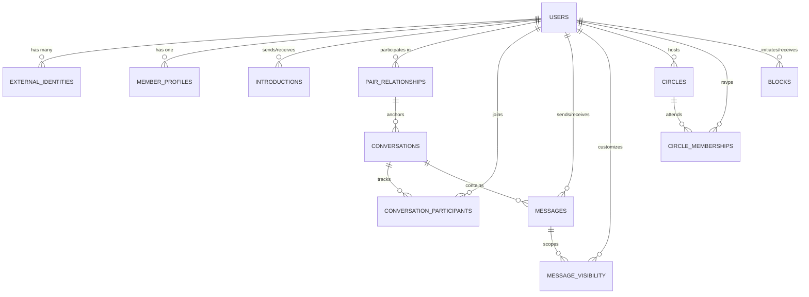

# KITHRA — PHASE 14: DATABASE RELATIONSHIP SCHEMA
## Entity Relationship Architecture & Relational Integrity

**Database:** Cloudflare D1 (SQLite Dialect)  
**High Availability:** Singapore (`SIN`) APAC Region

---

### 1. Entity-Relationship Diagram

---

### 2. Core Relational Tables & Primary Keys

| Table Name | Primary Key | Foreign Keys | Key Invariant / Index |
| :--- | :--- | :--- | :--- |
| `users` | `id` | None | Permanent opaque internal ID (`usr_...`) |
| `external_identities` | `id` | `user_id -> users(id)` | `UNIQUE(provider, provider_subject_id)` |
| `member_profiles` | `member_id` | `member_id -> users(id)` | PII scrubbed on account erasure |
| `pair_relationships` | `pair_id` | `member_a_id -> users(id)`, `member_b_id -> users(id)` | `suppression_status = 'all_spaces_suppressed'` |
| `conversations` | `id` | `pair_id -> pair_relationships(pair_id)` | Scoped strictly to canonical pair and space |
| `conversation_participants` | `(conversation_id, member_id)` | `conversation_id -> conversations(id)`, `member_id -> users(id)` | `is_hidden` for independent inbox suppression |
| `messages` | `id` | `conversation_id -> conversations(id)`, `sender_id -> users(id)`, `receiver_id -> users(id)` | `idempotency_key`, `is_unsent` |
| `message_visibility` | `(message_id, member_id)` | `message_id -> messages(id)`, `member_id -> users(id)` | `is_hidden` for "Delete for Me" |
| `circles` | `id` | `creator_id -> users(id)` | `max_capacity` (6–22 members), `venue_details` protected |
| `circle_memberships` | `(circle_id, member_id)` | `circle_id -> circles(id)`, `member_id -> users(id)` | `rsvp_status IN ('confirmed', 'waitlist', 'declined')` |
| `blocks` | `id` | `blocker_id -> users(id)`, `blocked_id -> users(id)` | Bilateral exclusion across all 4 spaces |
| `introductions` | `id` | `sender_id -> users(id)`, `receiver_id -> users(id)` | Unidirectional $\rightarrow$ Bidirectional state machine |
