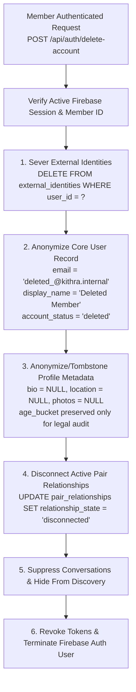

# KITHRA — PHASE 13: ACCOUNT DELETION AND DATA RETENTION
## DPDP Act 2023 (Section 12) & Right to Erasure Implementation

**Statutory Framework:** Digital Personal Data Protection Act 2023 (India), Section 12 — Right to Correction and Erasure of Personal Data.  
**Compliance Mandate:** Irreversible anonymization of personally identifiable information (PII) upon verified member request.

---

### 1. Erasure Architecture & Workflow

When Member A initiates "Delete My Account" via settings or authenticated API:



---

### 2. Concrete Database Execution

The D1 database layer executes atomic anonymization queries:

```sql
-- 1. Sever identity provider link (stops future SSO auto-logins)
DELETE FROM external_identities WHERE user_id = ?;

-- 2. Strip PII from core users table
UPDATE users 
SET display_name = 'Deleted Member',
    email = 'deleted_' || id || '@kithra.internal',
    account_status = 'deleted',
    deletion_requested_at = ?,
    updated_at = ?
WHERE id = ?;

-- 3. Strip member profiles PII
UPDATE member_profiles
SET bio = '',
    city = 'Confidential',
    photos_json = '[]',
    interests_json = '[]',
    updated_at = ?
WHERE member_id = ?;

-- 4. Terminate active pairs
UPDATE pair_relationships
SET relationship_state = 'disconnected',
    updated_at = ?
WHERE member_a_id = ? OR member_b_id = ?;
```

---

### 3. Data Retention and Partner Integrity

- **Why Not `DELETE FROM messages` Cascading?**
  If Member A's messages were deleted outright from the database, Member B's conversational context would be corrupted (orphan gaps, one-sided conversations).
  Instead:
  - Member A's display name is replaced with `"Deleted Member"`.
  - Member A's avatar is replaced with a neutral tombstone glyph.
  - Member A cannot log in, receive messages, or be rediscovered.
  - Member B retains their personal conversational transcript without PII linking back to Member A's real-world identity.
- **Audit Logs:** Block records and safety reports are retained in pseudonymized format (`usr_xxx blocked usr_yyy`) to satisfy compliance mandates regarding harassment prevention, while all identifiable profile content is purged.
