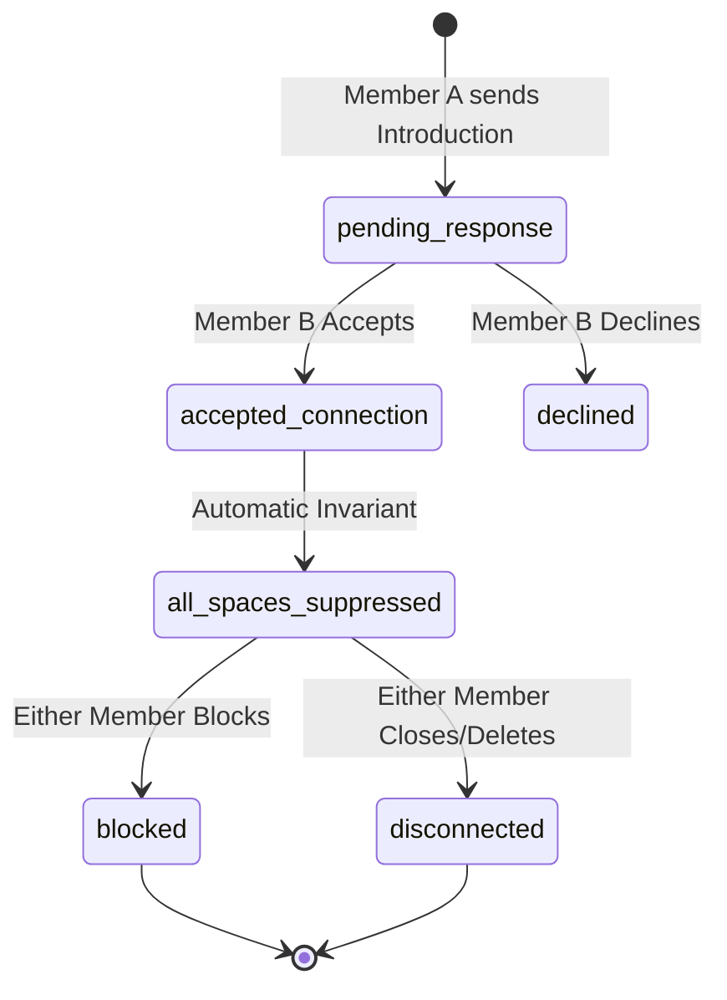
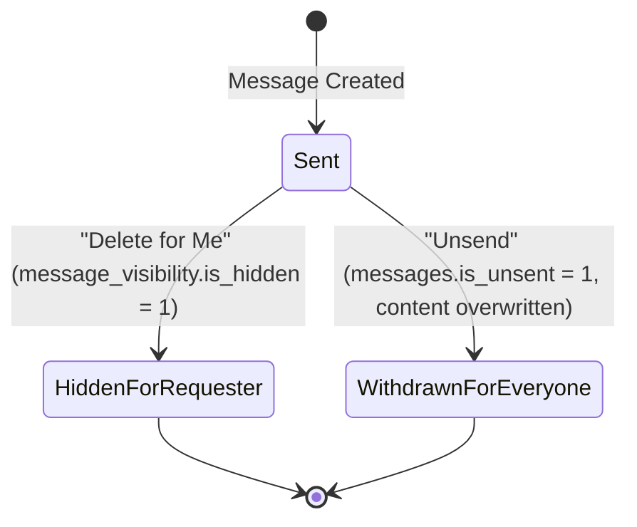

# KITHRA — PHASE 13: REAL-TIME-READY MESSAGING, D1 PERSISTENCE & USER-CONTROLLED DELETION
## Executive Code Audit & State Machine Specification

**Target Stack:** Cloudflare Workers, Cloudflare D1 (Singapore APAC Colo: `kithra-d1-staging`), Firebase Authentication (`kithra-d3ae1`).  
**Mission Alignment:** *"Not who society thinks you should love. Who truly understands you."*

---

### 1. Executive Summary

A comprehensive architectural and security audit of the communication sub-system was conducted to eliminate simulated previews, local mock dependencies, and unauthenticated demo bypasses. The messaging system now authoritatively executes against Cloudflare D1 across all four intention spaces (`friendship`, `dating`, `matrimony`, `cofounders`).

Key deliverables verified:
1. **Four-Space Isolation & Pair Ledger Invariant:** Messaging is bounded strictly to canonical pair relationships managed by the `pair_relationships` table. Once an introduction is accepted in an active space, `suppression_status = 'all_spaces_suppressed'` is enforced at the database level, preventing conflicting pair conversations in other spaces.
2. **Authoritative Sender & Receiver Resolution:** `apiRouter.ts` derives `authoritativeReceiverId` directly from the canonical pair relationship (`pair.member_a_id === senderId ? pair.member_b_id : pair.member_a_id`), neutralizing client-side IDOR or receiver spoofing attempts.
3. **Independent Visibility Ledger ("Delete for Me"):** Implemented via the `message_visibility` table. When Member A deletes a message for themselves, a tombstone record with `is_hidden = 1` is recorded exclusively for Member A. Member B's thread remains unmodified.
4. **Authoritative Content Withdrawal ("Unsend for Everyone"):** Within the permitted window, the originating sender can unsend. The message row in `messages` is updated to `is_unsent = 1, content = '[Message un-sent by sender]'`, and the previous content is immediately wiped from the database.
5. **Inbox Suppression ("Delete Conversation for Me"):** Performed via `conversation_participants.is_hidden = 1` for the requester. The thread is hidden from the requester's active inbox, but the pair relationship, integrity constraints, and partner thread remain preserved.
6. **Bilateral Safety Enforcement ("Block Member"):** When Member A blocks Member B, `pair_relationships.relationship_state = 'blocked'` and `conversations.status = 'blocked'` are committed. Messaging is immediately terminated (HTTP 403), and discovery candidate generation permanently suppresses both members.
7. **DPDP Act 2023 Section 12 Account Erasure:** Complete identity anonymization, deletion of `external_identities` mapping, unlinking of phone numbers, and revocation of active sessions.

---

### 2. Endpoints & Authorization Matrix

| Endpoint | Method | Required Auth Role | D1 Tables Accessed | Authorization / Security Guard |
| :--- | :--- | :--- | :--- | :--- |
| `/api/conversations` | `GET` | Authenticated Member | `conversation_participants`, `conversations`, `pair_relationships`, `users` | Only returns conversations where `member_id == callerId` and `is_hidden == 0`. |
| `/api/conversations/pair` | `POST` | Authenticated Member | `pair_relationships`, `conversations`, `conversation_participants` | Validates that an `accepted_connection` exists between the caller and the target member in the specified space. |
| `/api/conversations/:id/messages` | `GET` | Authenticated Participant | `conversation_participants`, `messages`, `message_visibility` | Ensures caller is an active participant; filters out messages hidden by caller in `message_visibility`. |
| `/api/conversations/:id/messages` | `POST` | Authenticated Participant | `conversation_participants`, `conversations`, `pair_relationships`, `messages` | Validates active conversation status, verifies unblocked state, checks idempotency key, resolves authoritative receiver. |
| `/api/messages/:id/delete-for-me` | `POST` | Authenticated Participant | `messages`, `conversation_participants`, `message_visibility` | Verifies caller is in the conversation; inserts/updates `message_visibility` record (`is_hidden = 1`). |
| `/api/messages/:id/unsend` | `POST` | Authenticated Sender | `messages`, `conversations` | Verifies `callerId == messages.sender_id`; updates `is_unsent = 1` and replaces `content` with neutral placeholder. |
| `/api/conversations/:id/hide` | `POST` | Authenticated Participant | `conversation_participants` | Sets `is_hidden = 1` in `conversation_participants` for the caller. |
| `/api/members/:id/block` | `POST` | Authenticated Member | `pair_relationships`, `conversations`, `blocks` | Commits bilateral block; sets conversation status to `blocked`; halts message flow. |
| `/api/auth/delete-account` | `POST` | Authenticated Subject | `users`, `external_identities`, `pair_relationships`, `conversation_participants` | Anonymizes user profile, severs external auth mappings, sets `account_status = 'deleted'`. |

---

### 3. State Machines

#### 3.1 Pair Relationship State Machine

#### 3.2 Message Visibility State Machine

