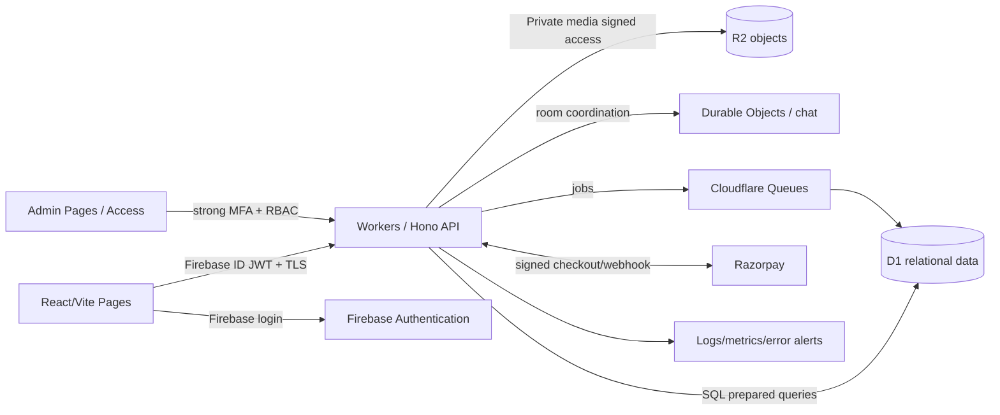

> **Historical basis — updated for v3.** For conflicts, the new v3 authorities prevail. This file is supporting detail, not a claim of working code.

# SAD / TAD / ADR — Serverless Architecture, Operations & Server Migration

**Architecture decision:** Cloudflare Pages + Workers + D1 + R2 + Durable Objects + Queues, Firebase Auth, Razorpay (India) for the validated controlled production validation. Workers API can later move to Node.js or container services; D1 can later move to PostgreSQL; R2 uses S3-compatible storage API. This is a target, not a claim that the source ZIP already runs on Cloudflare.

## 1. Current concept ZIP versus target
The ZIP uses Vite/React 19/TypeScript, Tailwind 4, Motion/Framer Motion, component-level `useState` and static data; `src/App.tsx` sets `DEFAULT_REPORT` and mock matches. `src/components/AuthModal.tsx` demo OTP accepts six digits and admin condition accepts any nonempty password. `src/components/AdminView.tsx` displays hardcoded sample cases and metrics. `src/components/SecurityView.tsx` claims Signal E2EE but simulates export. No production database, API, authorized messages, billing webhooks, data-rights service or admin auth is shown. **Retain UI-independent reusable TS components; replace the untrusted interaction and state logic.**

## 2. Context architecture

Do not allow direct browser D1 access. Auth JWT verification is local at edge with Google public signing keys and verified `aud`, `iss`, `exp`, `sub`; also check the Kithra account's `disabled`, `token_valid_after`/session-revocation state from D1. Cache public keys with HTTP TTL, implement fail-closed validation. This avoids embedding Firebase Admin SDK assumptions in Workers.

## 3. Repos/packages and boundaries
```
apps/web/                 # public app + authenticated user workspace
apps/admin/               # distinct admin frontend / origin
apps/api/                 # Workers entry + routes + Durable Objects
packages/ui/              # accessible token-based components
packages/domain/          # pure TS entities, policies, scoring (no Cloudflare SDK)
packages/contracts/       # Zod + OpenAPI types and events
packages/adapters/        # interfaces + D1/R2/Firebase/Razorpay adapters
packages/observability/   # scrubbed structured logs and tracing
migrations/d1/            # forward/rollback schema migrations
infra/wrangler/           # env-specific deployment, flags
research/quiz-banks/      # non-prod placeholders and review metadata
```
Dependency rule: domain cannot import D1/Cloudflare/Firebase/React. API uses `UserRepository`, `AssessmentRepository`, `ObjectStore`, `AuthVerifier`, `PaymentGateway`, `EventBus`, `RealtimeChannel`, `SecretsProvider` interfaces injected from provider adapters.

## 4. Cloudflare resource decisions
- **Pages:** static Vite bundle; preview branch builds; route fallback for SPA; `Content-Security-Policy` and secure headers. Pages Functions count against Workers usage, so a single Hono API Worker is easier to monitor.
- **Workers:** Hono HTTP routing, validation, authorization, scoring small batches; Free includes 100k requests/day and 10ms CPU per invocation; scheduled/queue and heavy ML tasks must stay within product limits and be offloaded to paid plans or external service.
- **D1:** relational entities and indexes; Free 5 million rows read/day, 100k rows written/day, 5GB account storage but only **500MB maximum per individual Free database**; constraints reset by plan. Favor compact rows, indexes and TTL; store media in R2; do not store entire chat media or raw embeddings in D1. Paid individual DB up to 10GB subject to current docs.
- **R2:** private avatars, consented media, temporary exports with lifecycle deletion; Standard Free 10GB-month, 1M Class A and 10M Class B operations/month. Bucket/private objects require signed APIs; default public bucket disabled; short-lived signed reads, MIME sniffing and malware scan process.
- **Durable Objects:** optional per-room chat coordinator using SQLite backend supported on Free; WebSocket hibernation and persistence. **D1 persists message records** and DO handles presence/fanout; DO isn't a permanent single source of truth for all conversations. Per-room authorization on join and every command; protect against message spoofing.
- **Queues:** welcome notifications, transcript-safe score recompute, email, media scanning, deletion and export jobs; 10,000 free operations/day as checked; DLQ, retry, idempotency. No critical report relying solely on eventually processed queue—immediate case persistence first.
- **Cron:** overdue grievance escalation, retention sweep, billing reconciliation, expired requests, consent revocation cleanup, backup verification and analytics aggregates.
- **Turnstile/WAF/Rate Limits:** bot reduction not security replacement; dedicated token buckets keyed by authenticated ID and risk IP.

**Official verified docs:** https://developers.cloudflare.com/workers/platform/pricing/ ; https://developers.cloudflare.com/d1/platform/pricing/ ; https://developers.cloudflare.com/d1/platform/limits/ ; https://developers.cloudflare.com/r2/pricing/ ; https://developers.cloudflare.com/durable-objects/platform/pricing/ ; https://developers.cloudflare.com/queues/platform/pricing/ . Verified 2026-11-01. Prices and feature limits must be rechecked at implementation time.

## 5. Authentication ADR-001: Firebase Auth or Supabase Auth?
| Decision factor | Firebase Auth | Supabase Auth |
|---|---|---|
| Email/password and Google | supported, recommended initial | supported |
| Phone OTP | available, SMS charged; enable later | phone requires SMS provider and associated charges |
| Cloudflare Worker JWT validation | RSA public keys/JWKS-like Google cert endpoint; manual validation | project JWKS with asymmetric signing keys (check key configuration) |
| Persistence fit | D1 primary, Firebase only for identity | Supabase project introduces idle Postgres if not using it |
| Free allowances | provider-dependent, Identity Platform 50k tier1 MAUs before charges | free 50k MAUs; inactive project may pause |
| Migration | independent Kithra user ID and provider identities | likewise |

**Decision:** Firebase for controlled production validation, with email/password or Google, verified email and no mandatory phone. Future phone must use abuse budgets. Admins use a separately authenticated email/password sign-in with strong MFA (passkey/TOTP as supported by selected provider), server-side role and optionally Cloudflare Access protective layer. A secret URL/email/password **alone is insufficient**. No open admin registration; seed first superadmin through secure audited setup, not frontend.

## 6. Authentication token and session design
`external_identity(provider, subject)` maps to Kithra `users.id` UUID (not the email, phone or Firebase UID as the long-lived domain key). Worker validates issuer/audience/time/signature and retrieves active account. New users require verifiable user/email action; new admin membership requires dual approval for privileged roles. Credential reset and email changes revoke privileged sessions. Sessions expire and are rotated; revocation within bounded window documented. For high-risk admin action demand recent reauthentication and second approver.

## 7. Payments ADR-002
Use Razorpay Checkout/Subscriptions where the merchant account and the exact plan/auto-debit mechanism are approved and live. Browser success redirect is never authority. Verify signed webhook HMAC on raw body, deduplicate provider event IDs, write payment ledger before entitlement change; compare local state against gateway periodically. Do not store card details. Monthly/quarterly/half-yearly/annual offers require clear taxes, renewal, consent and cancellation; review RBI e-mandate support for each method.

## 8. Data location & privacy caveat
Cloudflare D1's default location is automatic; its jurisdiction controls are not equivalent to a guaranteed Indian-only region. Firebase may store/process identity data in chosen provider infrastructure; verify terms, subprocessors, transfers and data residency before using it for intimate data. No unverified claim that all data remains physically in India. Encrypt raw responses at field/application level using audited key management and limit decryption to scoring services; retain keys out of code and source. Revisit localization laws with counsel.

## 9. Cost and failure management
Pilot volume model: 1,000 signups × 3 modes × 2 themes ×100 answer records can create 600k answer rows, quickly stressing DB and writes; use assignment-completion snapshots, compact indexed records and batch API operations, not raw new row per UI keystroke. Chargeable variables: Workers request/CPU, D1 rows and storage, DO message operations, R2 ops/storage, Firebase SMS, email transactional sends, media moderation, payments, support and legal. Set budget alerts and **hard feature-level limits**; avoid runaway async model inference. Do not forecast ₹0 hosting for a real community without traffic tests.

## 10. Server migration blueprint
**Trigger options:** increased active users and writes, D1 query hot spots, requirement for complex vector searches, regulatory hosting commitments, heavy media/ML workloads, or 99.9%+ supported SLA. **Target A:** Cloudflare Pages + API Node.js containers on managed VM/Kubernetes + PostgreSQL + Redis + S3-compatible objects + Firebase or migration to self-owned auth. **Target B:** keep Workers as public API gateway and migrate only matching/SQL to Postgres service. Steps: (1) create repository adapters; (2) shadow reads and reconcile; (3) bulk export and PII-preserving import; (4) dual-write outbox with idempotent replay; (5) read routing feature flag; (6) compare counts/foreign keys/hashes; (7) promote new system; (8) rollback within a test-proven RPO; (9) maintain deletion tombstones across all replicas/backups. Migration requires tested security model parity.

## 11. Operational playbooks
Build + test per pull request, preview deploy, staging smoke tests, signed release, production canary, RUM and alerts, daily encrypted backup verification, monthly manual restore test during controlled production validation, periodic vulnerability scan, quarterly incident tabletop. Keep separate Cloudflare/Firebase/Razorpay administrator accounts with strongest available MFA and at least two emergency authorized owners; secrets rotation documented. Emergency switch disables discovery/chat while still allowing account/data-rights and safety access.

## 12. Architecture decision register (ADRs)
ADR001 Firebase Auth (accepted provisionally). ADR002 Razorpay (pending merchant approval). ADR003 D1 primary relational (controlled production validation only). ADR004 R2 private files (accepted). ADR005 no fabricated E2EE (accepted). ADR006 opaque explainable score bands not probability (accepted). ADR007 18+ controlled production validation (accepted pending legal review). ADR008 separate mode personas (accepted). ADR009 PII/psychometric protection by field-level encryption and service isolation (requires technical spike). ADR010 admin on separate origin with MFA+RBAC+audit (accepted).
